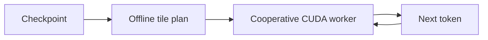

# Tiles

An experimental inference engine for [Llama 3.2 1B](https://huggingface.co/meta-llama/Llama-3.2-1B),
built on an 8 GB RTX 3050.

The idea is to execute a decoder as a program of small tensor tiles. Python
builds the task graph and schedule offline; a cooperative C++/CUDA worker
executes that schedule once per token and loops over tokens inside the
kernel, up to 64 per launch. Weights and K/V state stay on the GPU, and the
worker itself selects and feeds back the next token.



The executor runs fixed waves separated by grid barriers. Finer-grained
dataflow scheduling (dependency counters in place of barriers) was tested and
did not win for this model and hardware, because the work on both sides of
each barrier is already balanced.

## Results

Batch-one BF16 decode, ms per token, with clocks locked and runtimes
interleaved under a [controlled protocol](docs/architecture.md#measurement).
The floor is the time to stream every weight and K/V byte once at the
measured 212.9 GB/s.

| Context | Floor | Tiles | PyTorch CUDA Graph | llama.cpp |
| ---: | ---: | ---: | ---: | ---: |
| 1 | 11.61 | **12.13** (96%) | 12.84 (90%) | 13.68 (85%) |
| 4,096 | 12.24 | **12.99** (94%) | 20.34 (60%) | 14.32 (85%) |

The [development log](docs/development.md#final-results) has the full table,
generation timings, and the caveats of each comparison.

## Requirements

- An NVIDIA GPU of compute capability 8.6. The presets build for `sm_86`
  only, and worker counts, chunk sizes, and launch lengths were tuned on an
  RTX 3050; other GPUs need a new probe and package and are untested.
- Linux with the CUDA toolkit at `/usr/local/cuda` (measured with CUDA 13.4),
  CMake 3.24 or newer, Ninja, and a C++23 host compiler.
- [`uv`](https://docs.astral.sh/uv/); it installs the pinned Python 3.14
  environment from `tileplan/uv.lock`.
- The gated Llama 3.2 1B checkpoint, downloaded with your own Hugging Face
  account ([setup](tileplan/README.md#checkpoint-setup)).

## Try it

With the [pinned checkpoint](tileplan/README.md#checkpoint-setup) in
`checkpoints/Llama-3.2-1B`, run from the repository root:

```sh
./generate.py "The capital of France is"
./generate.py "Once upon a time" --max-new-tokens 32
./generate.py "The capital of France is" --dtype float32
```

`generate.py` builds the runtime, probes the compiled worker, imports a package,
and prints the continuation and timing. New packages default to BF16 weights,
activations, and K/V; `--dtype float32` selects the pure-float32 path.

Reuse a package with `--package runs/llama32-…`; an omitted `--dtype` follows
the package, and an explicit one must match it. Each run prints its
output directory. The checkpoint is the base model, so prompts are text
continuations rather than chat messages.

## Explore

- [TilePlan](tileplan/README.md): checkpoint setup, packages, and graph visualization.
- [TileInfer](tileinfer/README.md): runtime API, tests, and PyTorch eager/graph measurements.
- [Architecture](docs/architecture.md): the package, the worker, the numerical contract, and the repository layout.
- [Development log](docs/development.md): milestones, measurements, and negative results.
- [Showcase](experiments/showcase/README.md): one command that measures TileInfer
  against PyTorch and llama.cpp and draws the figures.
- [Milestone write-ups](docs/blog/): the October 2026 posts and their figures.

## Status

This is a research prototype: batch one, greedy decoding, one checkpoint,
one GPU. It is not a serving engine, and the package format changes without
migration. See [limits and open directions](docs/architecture.md#limits-and-open-directions).

## License

The code is released under the [MIT License](LICENSE). The bundled
[nlohmann/json](https://github.com/nlohmann/json) and
[PicoSHA2](https://github.com/okdshin/PicoSHA2) headers in
`tileinfer/third_party/` keep their own MIT licenses. Llama 3.2 weights are
not included and are subject to Meta's
[Llama 3.2 Community License](https://huggingface.co/meta-llama/Llama-3.2-1B/blob/main/LICENSE.txt).
