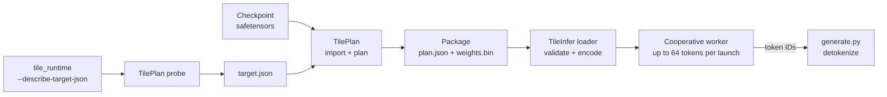

# Architecture

Tiles decodes [Llama 3.2 1B](https://huggingface.co/meta-llama/Llama-3.2-1B)
at batch size one on an 8 GB RTX 3050. The decoder runs as a program of small tile
tasks: Python builds the task graph and schedule offline, and one cooperative
C++/CUDA kernel executes that schedule for each token, up to 64 tokens per
launch. This document describes the design and the state of the repository.
How the design got here, with its measurements and negative results, is in
[the development log](development.md).

## The idea

Batch-one decode reads every weight once per token and does about one
multiply-add per weight. On this GPU it is limited by DRAM bandwidth: the
2.47 GB of BF16 weights take 11.61 ms at the measured 212.9 GB/s, so that is
the floor for one token. A runtime gets close to the floor only if DRAM
streams weights the whole time. Kernel launches, operator boundaries,
unbalanced work, and small serial phases all leave it idle.

Tiles therefore treats the token as one static program:

- **Tile tasks, not operators.** Every projection, attention chunk, and
  stack stage is split into tasks that each own a disjoint output range.
  The graph has one node per task.
- **A static schedule.** The offline planner places tasks into waves and
  assigns each task to a logical worker. Each worker receives an ordered
  instruction stream; nothing is chosen at run time.
- **One persistent kernel.** One cooperative launch, one block per SM, runs
  every worker's stream. Grid barriers separate waves. Weights, K/V, and the
  next token stay on the GPU.
- **Validated before running.** The C++ loader rechecks the whole schedule
  symbolically: every read sees the value its producer wrote in an earlier
  wave, and no two tasks in one wave conflict.

The result, measured under a controlled protocol, is 12.13 ms per token at
context 1 and 12.99 ms at 4K: 96% and 94% of the streaming floor, and faster
than PyTorch CUDA Graph replay and llama.cpp at every measured context
([results](development.md#final-results)).

## Pipeline



1. **Probe.** TilePlan asks the compiled worker for device facts and its own
   occupancy (`cudaOccupancyMaxActiveBlocksPerMultiprocessor` on the actual
   kernel), then writes `target.json`: one logical worker per SM, the block
   size, the shared attention region, and the worker's ABI fingerprint.
   Reprobe after any change to the worker or the toolchain.
2. **Plan.** `tileplan import-llama32` reads the pinned checkpoint, checks
   its config, maps every tensor, and writes a package for one target, one
   precision, and one maximum context.
3. **Load.** TileInfer validates the package against the current GPU and
   binary, uploads weights and instruction streams once, and creates
   per-sequence contexts.
4. **Run.** `generate.py` tokenizes in Python, the runtime prefills and
   generates on the GPU, and only the selected token IDs come back.

Python is the offline planner, fixture generator, baseline runner, and
orchestrator. It is never on the per-token path.

## Hardware and model

| RTX 3050 (as measured) | |
| --- | --- |
| Compute capability, SMs | 8.6, 20 SMs |
| Memory | 8 GB GDDR6, 224 GB/s nominal, 212.9 GB/s measured streaming read |
| L2 | 1.5 MB, so it never holds the weights |
| Grid barrier | 0.79 µs for an empty wave |
| One SM | streams about 30 GB/s; about 8 SMs saturate DRAM |
| Missing features | no TMA, no programmatic dependent launch (needs 9.0) |
| Kernel watchdog | active because a display is attached; limits launch length |

| Llama 3.2 1B base | |
| --- | --- |
| Revision | `4e20de362430cd3b72f300e6b0f18e50e7166e08` |
| Shape | hidden 2,048; 16 layers; 32 query heads, 8 K/V heads, head width 64; FFN 8,192; vocabulary 128,256 |
| RoPE | Llama 3 scaling, θ = 500,000, factor 32, original context 8,192; Hugging Face split-half pairing |
| Weights | 2,471,628,800 BF16 bytes; `lm_head` is tied to the embedding (21% of the bytes) |
| K/V | 32 KiB per token in BF16; a 4K-context package holds 128 MiB |

The package caps the context (4K in the showcase) to fit the 8 GB card next
to the weights, scratch, and CUDA runtime.

## Repository layout

| Path | Contents |
| --- | --- |
| [`generate.py`](../generate.py) | One-command text demo: builds, probes, imports, tokenizes, runs. |
| [`tileplan/`](../tileplan/README.md) | Offline Python planner: checkpoint import, CPU reference, scheduler, package writer, timeline analysis, visualization. |
| [`tileinfer/`](../tileinfer/README.md) | C++23/CUDA20 runtime: loader and validator, worker kernel, sequence contexts, CLI, tests and probes. |
| [`experiments/runtimes/`](../experiments/runtimes/README.md) | llama.cpp at a pinned release (`b11871`), its probe, and the cross-runtime harness, with their own lockfile. |
| [`experiments/showcase/`](../experiments/showcase/README.md) | The S6 command: checkpoint to comparison report and figures. |
| [`docs/blog/`](blog/) | Milestone write-ups, figure scripts, and figures. |

### TilePlan modules

| Module | Role |
| --- | --- |
| `llama32_import.py` | Reads `config.json` and safetensors, rejects unsupported variants, writes BF16 or float32 weights. |
| `decoder_reference.py` | Independent PyTorch/NumPy reference for both precision policies. |
| `plan_core.py` | Task graph, wave scheduler, worker assignment, attention chunk rule, plan serialization. |
| `decoder_block.py`, `decoder_stack.py` | One-block and full-stack packages, including the synthetic test fixtures. |
| `probe.py` | Turns the worker's capability report into `target.json`. |
| `package.py` | Package hashing and atomic writing. |
| `timeline.py`, `visualize.py` | Worker-trace analysis (loss budget, Gantt charts) and plan drawings. |

### TileInfer sources

| File | Role |
| --- | --- |
| `plan.hpp`, `plan.cpp` | Package records, opcodes, tensor IDs, JSON loader, hashes. |
| `plan_validation.cpp` | Operand, ownership, and symbolic dataflow checks; instruction-stream encoding. |
| `ops.cuh` | Device arithmetic: GEMV, attention, norms, RoPE, SiLU, embedding, logits. |
| `worker_kernel.cu` | The cooperative worker, its single launch wrapper, and the target probe. |
| `uploaded_plan.cu` | Immutable device weights and program, shared by contexts. |
| `sequence_context.cu`, `ticket.cu`, `snapshot.cu` | Per-sequence stream and buffers, enqueue and completion, diagnostic snapshots. |
| `runtime.hpp` | Public API: `DecoderModel`, `SequenceContext`, `Ticket`. |
| `diagnostic_context.cu`, `diagnostic.hpp` | Blocking checks, fixed-position benchmarks, timeline trace; linked only into `tile_runtime_test`. |
| `main.cpp` | `tile_runtime` and `tile_runtime_test` command lines. |

## The package

A package is a directory with three files, planned for one probed
`target.json` that the plan's `target` section records:

- `plan.json`: format version 10, the model shape and precision, tensor
  layout, storage sizes, and the task program with predecessors, waves, and
  workers. It is canonical JSON and its SHA-256 identifies the plan.
- `weights.bin`: contiguous little-endian weights in manifest order, with
  size and SHA-256 recorded in the plan. No pointers are serialized.
- `planning_report.json`: a summary for people (sizes, chunking, hashes);
  the runtime does not read it.

The loader reads only the current format; older packages must be
regenerated.

### One layer as tasks

Each decoder layer has six waves. Every projection splits its rows evenly
into one range per worker, so each wave holds about one task per worker.

| Wave | Opcode | One task | Fused into the task |
| --- | --- | --- | --- |
| 1 | `qkv` | a row range of `[Wq; Wk; Wv]` (3,072 rows) | attention RMSNorm; Q and K to scratch unrotated; V into the cache |
| 2 | `attention_scores` | one K/V head × one context chunk | RoPE of the group's 4 query heads and the current K row; chunk 0 writes the rotated K cache row; scores and chunk softmax statistics |
| 3 | `attention_values` | one K/V head × one context chunk | probabilities and the partial P·V |
| 4 | `output_projection` | a row range of `Wo` | combine the attention chunks; add the residual |
| 5 | `ffn` | one product chunk | FFN RMSNorm; gate and up rows; SiLU(gate)·up; that chunk's FP32 partial of the down projection over all outputs |
| 6 | `ffn_reduce` | a row range of the layer output | sum the 20 down partials in chunk order; round; add the residual |

The token adds `embedding` before layer 0 and `final_rms_norm` and `logits`
after layer 15. The full program has 99 waves.

Two layout choices follow from the schedule. `Wdown` is stored transposed
(`[f, d]`), so a worker's product chunk reads contiguous rows. The FFN's
split-K partials are reduced in a fixed order, never with float atomics, so
results are deterministic.

### Attention chunks follow the position

Attention work depends on the visible prefix, which changes every token. The
program contains chunk tasks for `max_context`; at run time, tasks of
inactive chunks return at once.

- Up to `attention_fused_steps` (default 384) visible positions, one fused
  task per K/V head keeps scores and probabilities in shared memory and
  finishes softmax and P·V itself. The barrier between waves 2 and 3 is a
  *conditional barrier*: every worker sees the same position, so every
  worker skips it together.
- Beyond that, the prefix splits into the fewest chunks of at most
  `attention_chunk_steps`, but at least two. The default chunk size is what
  the worker's shared attention region holds: 2,048 steps for Llama 3.2 1B in
  BF16, so 4K is two chunks, 16 tasks on 20 workers.

Attention loads K/V 16 bytes per lane, keeps several rows in flight, holds
`q` in registers, and reads each K/V row once for all four query heads of a
group.

### Greedy selection in the program

Each `logits` task also writes its rows' greedy candidate (the largest logit
and the lowest ID that holds it) into its own slot of a small selection
workspace. At the start of the next step every worker combines the 20
candidates, so all derive the same token and the same stop decision without
another barrier or a counter.

## The runtime

### Loading and validation

Loading is outside the timed path. The loader:

1. parses the plan, checks the format, ABI fingerprint, dtypes, shapes, and
   bounds, and verifies `weights.bin` against its size and hash;
2. checks the target: same SM count and block size, cooperative launch
   supported, and the grid fits the residency of the compiled worker;
3. checks every task's operands and output ownership, per layer and across
   shared scratch;
4. runs the schedule symbolically over the physical buffers (two alternating
   hidden vectors, shared scratch, per-layer K/V rows, attention and FFN
   workspaces, logits, selection slots) in both attention regimes. Every read
   must see its producer's value from an earlier wave, and no two tasks in a
   wave may write the same element or write what another reads;
5. encodes one instruction stream per worker, with a `barrier` instruction
   at the same stream position in every worker, and uploads everything once.

TilePlan validates the same graph before writing it. The C++ checks are
authoritative, because a package can be stale or built for another binary.

### The worker

A logical worker is one CUDA block of 1,024 threads; the grid has one block
per SM. Workers have no physical SM affinity, and correctness never depends
on placement. The compiled worker uses 64 registers per thread and keeps one
resident block per SM, which the probe confirms.

```text
for step in 0 .. steps-1:                 # up to 64 tokens per launch
    if generating: combine the 20 greedy candidates -> token, EOS, error
    for instr in my_stream:               # same barrier positions in every worker
        if instr is barrier: skip if conditional and fused, else grid.sync()
        else: run the opcode on its row range, layer, chunk
    grid.sync()                           # before the next step
```

The kernel has no hard-coded phases. The precision is a template parameter
(float32 or BF16), and opcodes carry no precision suffix on the device.
Each task finishes its block-local work before the next instruction; cross-
worker values go through global memory, ordered by the barriers.

Every worker reads the same EOS and error words, so all take the same
branch and every barrier stays legal. A NaN or infinite logit stops the
request with a device error, and every token is bounds-checked against the
vocabulary before the embedding lookup.

**Why 64 steps.** The display watchdog kills long kernels. 64 steps take
about 0.85 s at 4K context, so the runtime splits longer prefills and
generations into launches of at most 64 steps. Each launch first reads the
EOS and error words, so a stop in one launch makes the rest return at once.

### Sequences and the C++ API

[`runtime.hpp`](../tileinfer/src/runtime/runtime.hpp) separates immutable
model data from mutable sequence state:

- `DecoderModel` uploads a validated package once and can be shared by
  several contexts.
- `SequenceContext` owns one stream, the K/V cache, hidden and scratch
  buffers, the device token buffer, and a pinned input ring. A context
  allows one ordered stream of work.
- `enqueue_prefill`, `enqueue_decode`, `enqueue_generate`, and
  `enqueue_reset` return a move-only `Ticket` as soon as work is queued.
  `ready` polls, `wait` returns the `Completion` (token IDs, count, stop
  reason, final position), and nothing in normal generation synchronizes per
  token.
- Diagnostics (logits, K/V, block outputs) are requested at enqueue time, so
  their snapshots are captured before later tokens overwrite them.

Prefill runs the one-token program once per prompt token, up to 64 per
launch. The position advances only when a request completes; a failed
request invalidates the context until a reset. Because only the device knows
where a generation stopped, the next request on that context waits for it
and continues from there.

### Command lines

| Command | Purpose |
| --- | --- |
| `tile_runtime generate PACKAGE INPUTS.json --max-new-tokens N` | Greedy generation from token IDs. |
| `tile_runtime bench PACKAGE INPUTS.json --new-tokens N --warmup W --rounds R` | Times the generation path with EOS disabled. |
| `tile_runtime check PACKAGE INPUTS.json` | Per-token logits and K/V snapshots for regressions. |
| `tile_runtime --inspect-plan`, `--describe-target-json` | Package summary; worker probe. |
| `tile_runtime_test --benchmark-serve`, `--timeline-stack`, ... | Resident benchmark server and per-instruction trace (test build only). |

## Numerical contract

A package uses one of two policies for weights, activations, and K/V
together:

- **float32**: a precision reference, tested but not tuned.
- **BF16** (`hf-llama-eager-bf16-v1`, the default): reproduces the operator
  boundaries of Transformers 4.57.6 eager Llama on PyTorch 2.14.1.

Under BF16, weights, hidden states, projection results, residuals, K/V,
attention scores, and probabilities are BF16. Dot-product accumulation, norm
statistics, softmax, SiLU internals, and RoPE frequencies are FP32. The
rounding points matter: rounding a projection before adding the residual,
the norm before its scale, and SiLU before its product each changes about a
quarter of the outputs by up to 0.03 if skipped. The worker rounds where
PyTorch does, and the BF16 RMSNorm follows PyTorch's FP32 reduction order
exactly. Fusing operators into one task never moves a rounding point.
Matrix products use FP32 SIMT multiply-add over BF16 operands. Tensor cores
were measured slower for batch-one decode and are not used
([BF16 compute](development.md#bf16-compute)).

**Oracle.** Transformers eager attention on the same GPU, inference mode,
TF32 off, and BF16 reduced-precision reductions and split-K off, building
the prefix one token at a time.

**Tolerances.** Every element must satisfy
`abs(error) <= atol + rtol * abs(reference)`, and each stage's RMS must stay
under a ceiling. The BF16 limits were calibrated only from differences
between independent PyTorch runs (sequential against full-prefix, strict
against default cuBLAS), never from executor output. They are frozen in
[`bf16_checkpoint_tolerances.json`](../tileinfer/tests/bf16_checkpoint_tolerances.json):

| Stage | atol | rtol | RMS ceiling |
| --- | ---: | ---: | ---: |
| BF16 block outputs | .34 | .03 | .04 |
| BF16 K | .15 | .03 | .03 |
| BF16 V | .05 | .02 | .01 |
| BF16 logits | .18 | .03 | .07 |
| float32, every stage | .001 | .0001 | .001 |

Required prompts must also keep their greedy choices, except where the
reference's top two logits form a BF16 near-tie. The default package has
one known near-tie in the 27-step suite (margin 0.125). Bitwise equality
with PyTorch is not the goal; bitwise equality between versions is required
whenever a change does not alter the arithmetic order.

## Verification

Run these before any performance claim (see [AGENTS.md](../AGENTS.md)):

- clang-format, Ruff, and ty;
- the TilePlan unit tests, including the CPU reference and package
  regressions;
- CTest: the CCCL cooperative-launch gate, loader and UBSan cases, the
  device operator tests (`ops_unit`, the real `ops.cuh` routines against
  PyTorch, including tails, ties-to-even, and exact norms), block and stack
  regressions in both precisions, multi-launch generation, EOS, device
  errors, reset, capacity, and context and ticket lifetimes;
- the checkpoint comparison
  ([`llama32_checkpoint.py`](../tileinfer/tests/llama32_checkpoint.py)) under
  the frozen tolerances;
- Compute Sanitizer memcheck, racecheck, synccheck, and initcheck
  (`cmake --build build/release --target sanitizers`, several minutes).

The worker must be reprobed after any change to opcodes or the execution
loop, and packages regenerated if its fingerprint changes.

## Measurement

Timings are labelled *exploratory* (unlocked clocks, one session) or
*controlled*. The controlled protocol is
[`controlled_decode.py`](../tileinfer/tests/controlled_decode.py):

- every arm stays resident in its own server process;
- blocks of the arms alternate in time, in both spawn orders;
- a background `nvidia-smi` log records clocks, temperature, power, and
  throttle reasons;
- the report gives paired differences with bootstrap intervals;
- clocks are locked where possible (SM 1,950 MHz, memory 6,801 MHz).

An A/A run resolves about 10 µs per token (0.08%) in one session and 5 µs
with both spawn orders. A whole-token loss budget comes from
`tile_runtime_test --timeline-stack` and
[`profile_timeline.py`](../tileinfer/tests/profile_timeline.py): the trace
records every instruction on every worker and splits the token into ideal
streaming, per-phase excess, and barrier latency, measured against the
streaming roofline from `bandwidth_probe stream`.

Cross-runtime comparisons
([`experiments/showcase/`](../experiments/showcase/README.md)) follow these
rules:

- the same checkpoint everywhere: BF16 safetensors for TileInfer and
  PyTorch, a BF16 GGUF (norms F32) for llama.cpp, all layers on the GPU;
- token IDs, not text, are fed to every runtime;
- *decode* (logits ready) and *decode + selection* (next ID known) are never
  mixed in one column;
- PyTorch with SDPA attention and llama.cpp are separate numerical
  policies; parity is checked teacher-forced, and argmax mismatches are split
  into real ones and BF16 near-ties;
- every latency is also reported as a percentage of the streaming floor.

## Limits and open directions

- **Batch one, greedy only.** No sampling, batching, or serving loop.
- **Prefill is token by token.** A matrix prefill would need a different
  kernel and is not planned yet.
- **Fixed context capacity.** No paging or sliding window; the 128K context
  of the checkpoint does not fit this design on 8 GB.
- **One checkpoint.** The importer supports the pinned Llama 3.2 1B base
  model and rejects other variants. There is no chat template.
- **Waves, not dataflow.** Counter waits in place of barriers were probed
  and did not pay on this model (the work on both sides of each barrier is
  already balanced); the executor keeps grid barriers.
- **One RTX 3050.** Worker count, chunk sizes, and the 64-step launch limit
  are derived from this GPU. Another GPU needs a new probe and package, and
  its choices may differ.

The remaining 0.5 ms per token at context 1 is mostly GEMV streaming below
the roofline in the QKV, Wo, and FFN waves (about 0.32 ms), with about
0.1 ms each of barrier latency and attention.
