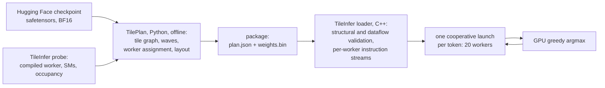
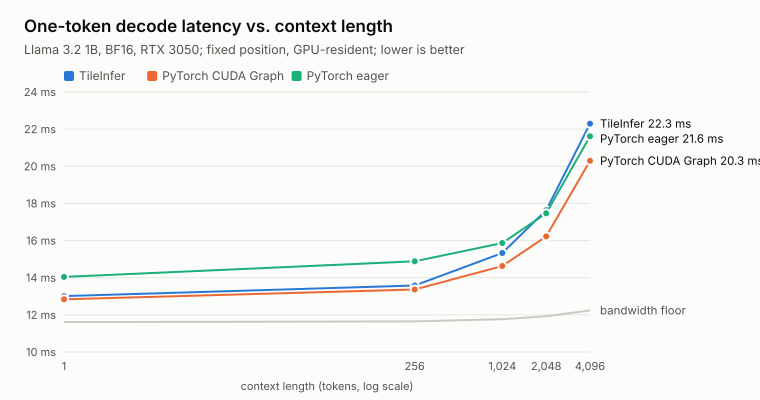
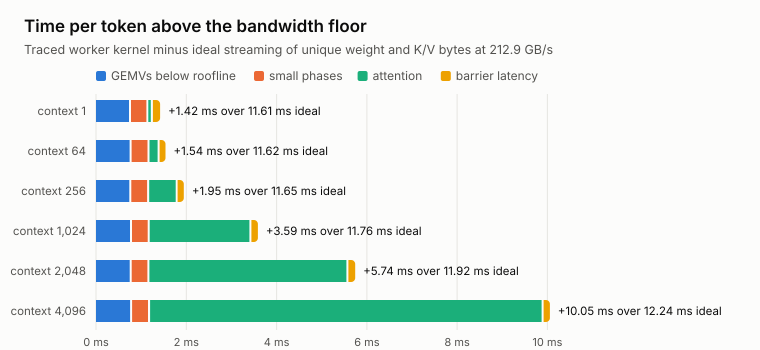
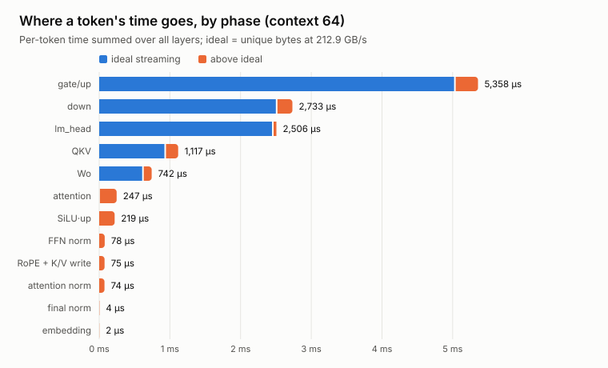
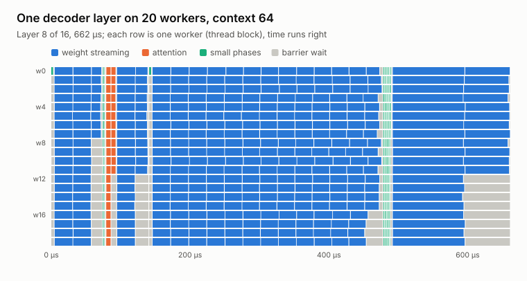
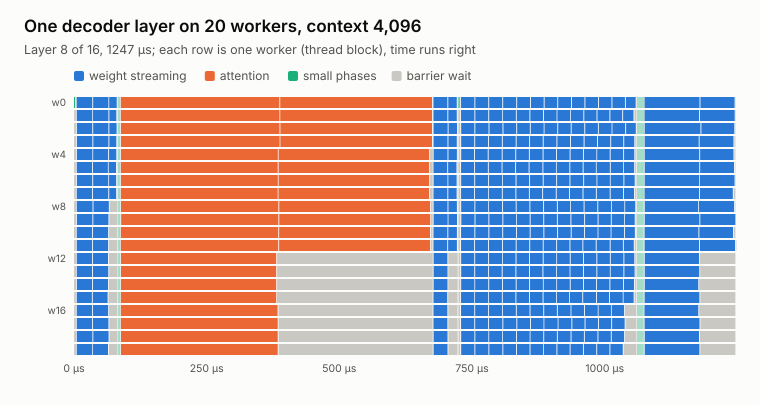
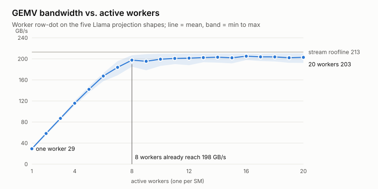

# Tiles: a tile-graph megakernel for Llama 3.2 1B — baseline, October 2026

Status record for the blog series. It captures what the prototype does today,
how fast it is, where the time goes, and what is still missing for
performance. Everything here was measured on one machine at commit `bbb9100`
(2026-10-22). Raw artifacts are in `runs/s0-2026-10-22/` on `tux`; the figures
are regenerated by [`make_figures.py`](make_figures.py) from that directory.
The plan behind the next steps is in
[the megakernel plan](../megakernel_next_steps.md).

## In one paragraph

Tiles runs batch-one, one-token decode of the Llama 3.2 1B base model on an
8 GB RTX 3050 as a **single persistent CUDA kernel per token**. An offline
Python planner splits the whole token into about 9,200 small *tile tasks*:
row slices of every projection, one attention head, one norm, and so on. It
orders them into dependency waves and assigns every task ahead of time to one
of 20 workers, one thread block per SM. The C++ runtime validates that
program, encodes one instruction stream per worker, and launches it as one
cooperative kernel. Today it produces the same tokens as PyTorch eager,
within calibrated BF16 tolerances, at **13.0 ms per token at context 1**. That
is 1.3% slower than PyTorch CUDA Graph replay of the same model (12.8 ms) and
12% above the hardware's memory-bandwidth floor (11.6 ms). The gap grows to
2 ms at a 4K-token context.

## The hardware and the model

| | |
| --- | --- |
| GPU | NVIDIA GeForce RTX 3050, 8 GB, compute capability 8.6 |
| SMs / L2 | 20 SMs, 1.5 MB L2 |
| DRAM | 128-bit GDDR6, 224 GB/s nominal, **212.9 GB/s measured** streaming read |
| Software | driver 595.99.02, CUDA 13.4, CCCL; PyTorch 2.14.1+cu130 and Transformers 4.57.6 for the baselines |
| Model | `meta-llama/Llama-3.2-1B` base, revision `4e20de36…`; 16 layers, hidden 2048, 32 query / 8 KV heads, FFN 8192, vocabulary 128,256, tied output embedding |
| Weights read per token | 2,471,628,800 bytes in BF16, including `lm_head` (525 MB, 21%) |
| K/V read per token | 32 KiB × context length (134 MB at 4K) |

Batch-one decode reads every weight once per token and does about one
multiply-add per two weight bytes, so it is bound by DRAM bandwidth, not
arithmetic. **The bandwidth floor is the yardstick for everything below:**
2.47 GB ÷ 212.9 GB/s = 11.61 ms per token, plus the K/V bytes at longer
contexts.

## What the code does



**TilePlan** (`tileplan/`, Python) is the offline compiler. It imports the
pinned checkpoint, packs BF16 weights, and builds the *whole-token program*:
- embedding rows split over the workers;
- each layer's graph: RMSNorm, Q/K/V projections in 64-row tiles, RoPE and
  K/V-cache write per head, attention per query head, the output projection
  with residual, a second RMSNorm, gate/up projections, SiLU·up, and the down
  projection with residual;
- final RMSNorm and `lm_head` rows split over the workers.

Every task is placed in its earliest legal wave and greedily balanced across
workers by estimated work. For Llama 3.2 1B this gives **9,180 tasks in 147
waves**: 1 for embedding, 9 per layer, and 2 for the output.

**TileInfer** (`tileinfer/`, C++23/CUDA 20) is the runtime. The loader does
not trust the package. It checks every task's operands and output
ownership. It then runs the schedule symbolically over the physical buffers,
including the two alternating hidden vectors and the scratch that all layers
share. Every read must see the value its producer wrote in an earlier wave,
and no two tasks in one wave may conflict on an element. It encodes one
instruction stream per worker with an explicit `barrier` instruction between
waves: 12,100 instructions (533 KB). The worker kernel is a loop over its
stream: dispatch the opcode, synchronize the block, move to the next
instruction. A `barrier` instruction is a grid-wide `cooperative_groups`
sync.

| Worker property | Value |
| --- | --- |
| Launch | CCCL cooperative launch, 20 blocks × 1,024 threads, one block per SM |
| Resources | 64 registers/thread, 2,264 bytes static shared memory |
| GEMV | one warp per output row, BF16 loads, FP32 accumulation, CUB warp reduce |
| Attention | one task per query head over the full visible prefix |
| Numerics | `hf-llama-eager-bf16-v1`: BF16 storage and rounding at PyTorch eager's operator boundaries; FP32 reductions |
| Generation | prompt fed token by token; GPU argmax feeds the next token; no host sync per token |

**Correctness.** On the pinned checkpoint, block outputs, K/V and logits match
Transformers eager within calibrated BF16 tolerances, and all 27 greedy
decisions on the frozen prompt suite agree. Refactors are checked bit for bit
against the previous build. The move to the whole-token program (format 5)
was bit-identical on fixtures and on a Llama check trace plus 48 generated
tokens. Each change runs clang-format, Ruff, ty, CTest (13 tests), a CPU-only
UBSan loader suite, and Compute Sanitizer memcheck, racecheck, synccheck and
initcheck (56 runs).

## Baseline performance

### Latency versus context



| Context | PyTorch eager | PyTorch CUDA Graph | TileInfer | TileInfer − Graph | Bandwidth floor |
| ---: | ---: | ---: | ---: | ---: | ---: |
| 1 | 14.04 ms | 12.84 ms | 13.01 ms | +0.18 ms | 11.61 ms |
| 256 | 14.89 ms | 13.37 ms | 13.58 ms | +0.22 ms | 11.65 ms |
| 1,024 | 15.87 ms | 14.63 ms | 15.33 ms | +0.70 ms | 11.77 ms |
| 2,048 | 17.47 ms | 16.22 ms | 17.63 ms | +1.41 ms | 11.92 ms |
| 4,096 | 21.62 ms | 20.30 ms | 22.29 ms | +1.99 ms | 12.24 ms |

These are fixed-position measurements: the prefix is filled first, and each
timed call overwrites the same cache slot, so the context length stays
constant. Times are CUDA-event batch averages (3 rounds of 5 calls) with
weights, input, and cache resident on the GPU. Both PyTorch paths use the
same BF16 checkpoint with eager attention and a static cache sized to the
context. TileInfer's column excludes its separate argmax kernel (0.165 ms;
see below).

**Generation.** With a 6-token prompt and 64 generated tokens, TileInfer
measures **13.28 ms/token (75 tokens/s)**. Nsight Systems splits this into
13.10 ms for the worker kernel, 0.165 ms for greedy selection, and about
8 µs of launch gaps. Session-to-session drift is about 0.6% with unlocked
clocks.

### Where the time goes

A trace mode records every instruction's start and end on every worker. SM
cycle counters give the resolution; the 1 µs `%globaltimer` aligns the
workers. The analysis splits each token into waves at barrier releases and
compares each wave with the time an ideal stream of its unique bytes would
need at 212.9 GB/s.



| Context | Traced kernel | Ideal stream | GEMVs below roofline | Small phases | Attention | Barrier latency |
| ---: | ---: | ---: | ---: | ---: | ---: | ---: |
| 1 | 13.03 ms | 11.61 ms | 0.77 ms | 0.38 ms | 0.10 ms | 0.16 ms |
| 64 | 13.16 ms | 11.62 ms | 0.79 ms | 0.40 ms | 0.22 ms | 0.13 ms |
| 256 | 13.59 ms | 11.65 ms | 0.78 ms | 0.40 ms | 0.63 ms | 0.14 ms |
| 1,024 | 15.35 ms | 11.77 ms | 0.80 ms | 0.39 ms | 2.25 ms | 0.15 ms |
| 2,048 | 17.67 ms | 11.92 ms | 0.79 ms | 0.39 ms | 4.41 ms | 0.15 ms |
| 4,096 | 22.29 ms | 12.24 ms | 0.80 ms | 0.40 ms | 8.72 ms | 0.14 ms |

The four loss components plus ideal streaming sum exactly to the traced
kernel time. Tracing itself adds 15–30 µs per token.



| Phase (context 64) | Time per token | Ideal | Achieved bandwidth |
| --- | ---: | ---: | ---: |
| gate/up projections | 5,358 µs | 5,043 µs | 200 GB/s |
| down projection | 2,733 µs | 2,521 µs | 196 GB/s |
| `lm_head` | 2,507 µs | 2,467 µs | 210 GB/s |
| Q/K/V projections | 1,117 µs | 946 µs | 180 GB/s |
| output projection (Wo) | 742 µs | 630 µs | 181 GB/s |
| attention | 247 µs | 10 µs | 8.5 GB/s |
| SiLU·up | 219 µs | — | — |
| FFN norm / attention norm | 78 / 74 µs | — | — |
| RoPE and K/V write | 75 µs | — | — |
| final norm, embedding | 6 µs | — | — |

### What one layer looks like on the workers



At context 64 one layer takes 662 µs. Weight streaming dominates. The small
phases (norm, RoPE, SiLU) are thin bands in which one worker or a few tiny
tasks run while the rest wait at the next barrier (gray). The uneven rounds
of the Q/K/V, Wo, and down waves leave 8–12 workers idle at the end of each
wave.



At context 4,096 the same layer takes 1,247 µs, and attention fills most of
it. There is one task per query head: 32 heads on 20 workers. Workers 0–11
run two heads back to back while workers 12–19 run one and then wait. Each
head task streams its K/V prefix from a single SM, so the attention waves
reach only 14 GB/s overall. Each K/V head is also requested four times, once
per query head in its group.

### How fast one worker is



| Active workers | 1 | 2 | 4 | 8 | 12 | 20 |
| --- | ---: | ---: | ---: | ---: | ---: | ---: |
| Mean GEMV bandwidth over the five projection shapes | 29 GB/s | 58 GB/s | 116 GB/s | 198 GB/s | 201 GB/s | 203 GB/s |

The worker's own GEMV routine, run on the five projection shapes with a grid
barrier after each GEMV, streams about 30 GB/s per worker and saturates DRAM
at about eight workers. Two consequences shape the next steps. Uneven tile
rounds cost little bandwidth: the 64-row tiles are at most 3.5% slower than
an even split. And **12 of the 20 SMs are not needed to keep DRAM busy**.
They are free capacity for attention, norms, and epilogues, if a schedule
lets that work overlap with weight streaming. One empty grid barrier costs
0.79 µs.

## What is missing for performance

Ordered by measured cost at short context, then by what matters at long
context. None of these needs new hardware features. They are scheduling and
kernel work.

| Gap | Measured cost per token | Planned fix |
| --- | --- | --- |
| Attention is one task per query head, single-SM streaming, K/V read 4× | 0.22 ms at 64, 2.25 ms at 1K, **8.72 ms at 4K** | GQA-grouped, context-split attention with a combine step |
| GEMV waves run below the roofline: each wave restarts its DRAM pipeline after a barrier, and Q/K/V and Wo reach only 180 GB/s | 0.79 ms | weight prefetch into shared memory across barriers; balanced tiles |
| Small phases each take a wave: SiLU·up (128 tiny tasks), two single-worker norms, RoPE | 0.40 ms | fuse into GEMV epilogues and prologues; producers emit norm partials |
| Greedy argmax is a separate one-block kernel over 128K logits | 0.165 ms | parallel argmax inside the worker program |
| 146 grid barriers per token | 0.13–0.16 ms | fewer waves (fusion); later, per-tile dependency counters instead of barriers |
| No overlap between waves: weights stop streaming during every barrier, norm, and attention wave | part of all the above | dataflow schedule that uses the 12 spare SMs |
| Prefill is one decode launch per prompt token | about 13 ms per prompt token (not benchmarked) | chunked, batched prefill (later; uses tensor cores) |

Also noted:
- The fixed-position comparison uses Hugging Face eager attention in both
  PyTorch paths. An SDPA-backed baseline would be stronger at long context
  and has not been run.
- All timings are exploratory, with unlocked clocks (SM about 1.95–1.97 GHz
  under load). They are not a controlled shape/tile sweep.
- The pure-float32 numerical policy is kept as a precision reference and is
  not tuned.

## How these numbers were produced

From `tux:~/dev/tiles` at `bbb9100`, with the 4K-context BF16 package at
`runs/s0-2026-10-22/package-4k`:

```sh
# bandwidth roofline and per-worker GEMV bandwidth
tileinfer/build/release/bandwidth_probe stream 2471628800 > runs/s0-2026-10-22/stream.json
tileinfer/build/release/bandwidth_probe rowdot > runs/s0-2026-10-22/rowdot.json

# fixed-context comparison with PyTorch eager and CUDA Graph
cd tileplan && uv run --locked --group checkpoint python ../tileinfer/tests/benchmark_decode.py \
  --checkpoint ../checkpoints/Llama-3.2-1B --package ../runs/s0-2026-10-22/package-4k \
  --executor ../tileinfer/build/release/tile_runtime_test \
  --positions 0 255 1023 2047 4095 --warmup 3 --iterations 5 --rounds 3 \
  --out ../runs/s0-2026-10-22/context-sweep.json && cd ..

# worker timelines and the time budget
uv run --locked --project tileplan python tileinfer/tests/profile_timeline.py \
  --executor tileinfer/build/release/tile_runtime_test \
  --package runs/s0-2026-10-22/package-4k --stream-report runs/s0-2026-10-22/stream.json \
  --positions 0 63 255 1023 2047 4095 --out runs/s0-2026-10-22/timeline

# raw traces for the Gantt figures, then the figures
for p in 63 4095; do
  tileinfer/build/release/tile_runtime_test --timeline-stack \
    runs/s0-2026-10-22/package-4k $p 1 3 3 > runs/s0-2026-10-22/traces/trace-p$p.json
done
uv run --locked --project tileplan python docs/blog/make_figures.py \
  runs/s0-2026-10-22 docs/blog/figures
```

The figures use a fixed, colorblind-validated categorical palette. Each mark
carries a tooltip when the SVG is opened directly, and every figure has its
data table above.
