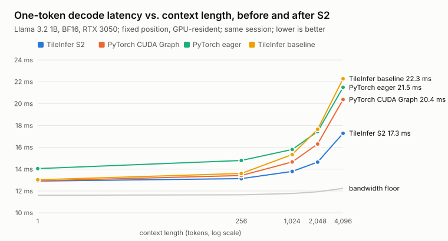
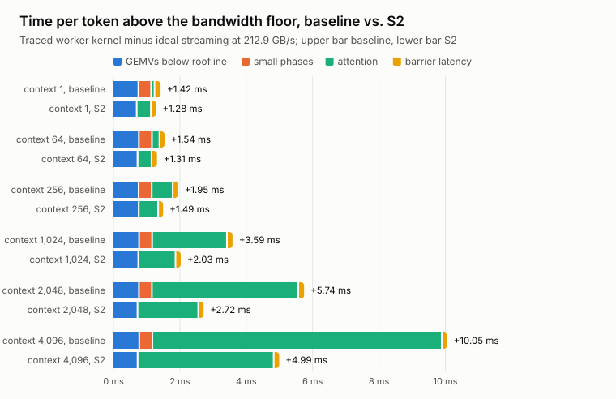
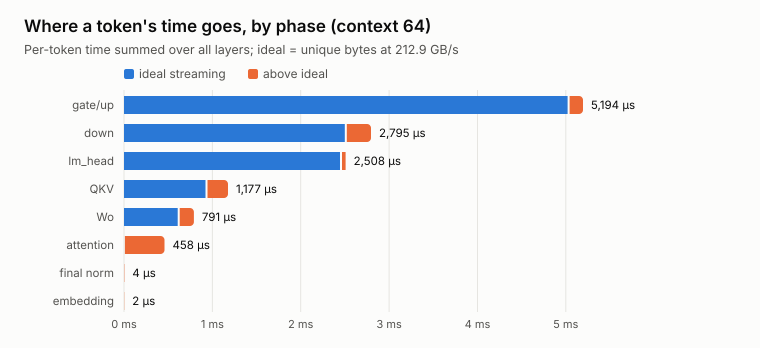
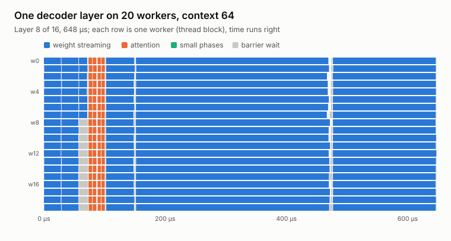
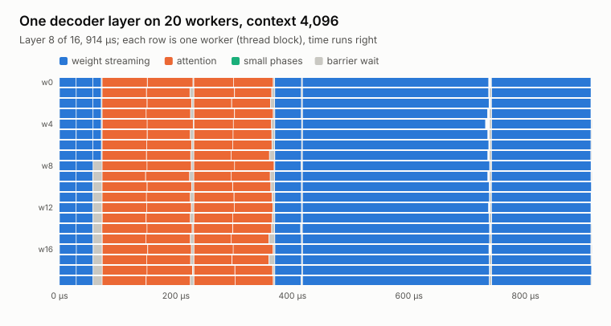

# Tiles S2: fewer, fatter tasks — and level with CUDA Graphs

Second status record for the blog series. It follows
[the October baseline](baseline-2026-10.md) and covers milestone S2 of
[the megakernel plan](../development.md#the-megakernel-plan). Everything here was
measured on the RTX 3050 on 2026-10-23, with the baseline rebuilt from commit
`bbb9100` and timed in the same session. Raw artifacts are in
`runs/s2-2026-10-23/` (not committed); the figures are regenerated by
[`make_figures.py`](make_figures.py) with `--baseline runs/s0-2026-10-22`.

## In one paragraph

The baseline spent about 0.4 ms of every token in small waves: norm, RoPE,
SiLU. Each moved almost no bytes, yet held all 20 workers at a grid barrier.
It also spent up to 8.7 ms in attention, with one task per query head
streaming its K/V prefix from a single SM. S2 folds the small phases into the
projections that consume or produce them. It splits attention by K/V head and
context chunk, so every worker shares the work and each K/V row is read once.
It replaces a slow argmax kernel. The program shrank from 9,180 tasks in 147
waves to 3,068 tasks in 99 waves, and the code got shorter: 812 fewer lines of
planner and runtime source. TileInfer now **matches PyTorch CUDA Graph replay
at context 1 (12.90 vs 12.92 ms) and beats it at every longer context, by
15% at 4K (17.22 vs 20.38 ms)**. Generation is 2.6% faster than the baseline
(77 tokens/s).

## What changed

### One layer, before and after

| Wave | Baseline (9 waves) | S2 (6 waves) |
| --- | --- | --- |
| 1 | attention RMSNorm (1 task) | **QKV**: one task per Q, K or V head (48). It normalizes the layer input into shared memory, projects the head's 64 rows, applies RoPE, and writes `q_rot` or the K/V cache row |
| 2 | Q/K/V projections (48 tiles of 64 rows) | **attention scores**: one task per K/V head × context chunk (8 × 5). Reads each K row once for all four query heads of the group; records the chunk's softmax maximum and sum |
| 3 | RoPE and cache write (40 tiny tasks) | **attention values**: same 40 tasks. Combine all chunks' statistics, round probabilities, accumulate a partial P·V |
| 4 | attention, one task per query head (32) | **output projection**: one row range per worker. Sums the chunk partials into the attention vector, then projects Wo and adds the residual |
| 5 | Wo projection (32 tiles) | **gate/up**: one row range per worker. Normalizes the attention output, computes gate and up rows together, writes SiLU(gate)·up |
| 6 | FFN RMSNorm (1 task) | **down**: one row range per worker, plus the residual |
| 7 | gate/up projections (256 tiles) | |
| 8 | SiLU·up (128 tiny tasks) | |
| 9 | down projection (32 tiles) | |

The full program is 1 embedding wave, 16 × 6 layer waves, and 2 output waves.
That's 99 waves instead of 147, and 5,028 encoded instructions (121 KB)
instead of 12,100 (533 KB).

### Why the fusions keep the numbers

The fusions keep every element's arithmetic and rounding exactly as before.
The QKV task's prologue computes the RMSNorm with the same reduction order
the separate norm task used. Its RoPE reads the rounded projection, as the
separate RoPE task did, and the SiLU·up epilogue rounds gate, up, and SiLU at
the same points. On the fixture block, the baseline and S2 builds produce
bit-identical Q, K, and V in both precisions. In BF16 the whole block is
bit-identical at these short contexts: attention, residual, FFN, and output.

Attention is the one deliberate change. Eager PyTorch rounds the scores and
the probabilities to BF16, and S2 keeps both of those rounding points. With
context chunks, though, the FP32 softmax denominator and the P·V sums add in
a different order, which shows up at longer contexts. The pure-FP32 policy's
attention also changed: its online softmax was replaced by the same two-pass
routine, so FP32 outputs differ slightly and stay within the FP32 test
tolerances.

| Check | Result |
| --- | --- |
| Fixture blocks and stacks (FP32 and BF16), CTest | 13/13 pass; CPU/UBSan loader suite 4/4 |
| Isolated operators, including every fused task and 1–5 chunk attention | 220 cases pass |
| Compute Sanitizer memcheck, racecheck, synccheck, initcheck | 56/56 pass |
| Llama 3.2 1B vs Transformers eager (calibrated BF16 tolerances) | all stages within tolerance; 27/27 greedy decisions match |
| Max abs error vs Transformers: blocks / K / V / logits | 0.125 / 0.1875 / 0.039 / 0.1875 (same as the baseline) |
| 6-token check trace vs the baseline build | bit-identical: every logit, K/V entry, and layer output |
| 48 generated tokens vs the baseline build | 47 of 48 identical; first difference at token 35 |

### Simpler code

The cleanup went along with the speedup, because the old flexibility was
mostly unused:

- **Fixed bindings instead of generic operands.** Every opcode now knows its
  tensors. The task record shrank from 11 fields (44 bytes) to 6 (24 bytes).
  The device-side tensor table is gone; a per-layer table of offsets replaces
  it, and one launch struct replaces 25 kernel arguments.
- **No tile sizes.** Projections split their rows into one range per worker,
  and Q/K/V split by head. The `tile_rows` parameter, the tile-search
  heuristic, `--tile-rows`, and the tile-sweep script are gone. The row-dot
  probe in the baseline showed that uneven 64-row tiles cost at most 3.5%.
- **Fewer scratch tensors.** `u`, `q`, `k`, `v`, `z`, `gate`, and `up` no
  longer exist. Scratch is `q_rot`, `attention`, `r`, and `product`, plus
  small FP32 attention partials.
- **One attention routine for both precisions.** The FP32 policy's separate
  online-softmax attention is gone.
- **Less visualization code.** The tensor-graph and tile-flow SVGs depicted
  tasks that no longer exist and are removed. The per-layer schedule view and
  the worker timelines remain.

Planner and runtime source shrank by 812 lines (859 added, 1,671 removed).
`ops.cuh` went from 580 to 488 lines, `decoder_plan.py` from 822 to 720, and
`tile_flow.py` (293 lines) is gone.

The worker still uses 64 registers per thread and one block per SM. Static
shared memory grew from 2.3 KB to 23.8 KB: a task's input vector and one
projected head now live there. The loader rejects models whose hidden size,
head width, or query-group size exceed those buffers (4096, 256, 8).

### A faster greedy selection

The separate argmax kernel took 165 µs per token: one 256-thread block made a
dependent scalar comparison per logit. S2 uses 1,024 threads, 16-byte loads,
and warp-shuffle reductions with the same lowest-ID tie rule. It now takes
**15 µs**.

## Results

### Latency versus context



| Context | PyTorch eager | PyTorch CUDA Graph | TileInfer baseline | TileInfer S2 | S2 − Graph | Floor |
| ---: | ---: | ---: | ---: | ---: | ---: | ---: |
| 1 | 14.05 ms | 12.92 ms | 13.02 ms | **12.90 ms** | −0.02 ms | 11.61 ms |
| 256 | 14.79 ms | 13.42 ms | 13.60 ms | **13.14 ms** | −0.28 ms | 11.65 ms |
| 1,024 | 15.80 ms | 14.66 ms | 15.33 ms | **13.79 ms** | −0.87 ms | 11.77 ms |
| 2,048 | 17.44 ms | 16.30 ms | 17.65 ms | **14.64 ms** | −1.66 ms | 11.92 ms |
| 4,096 | 21.49 ms | 20.38 ms | 22.28 ms | **17.22 ms** | −3.15 ms | 12.24 ms |

PyTorch and TileInfer S2 come from one run of the fixed-position comparison
script (3 rounds of 5 calls each). The baseline column is the mean of two
interleaved runs of the `bbb9100` build in the same session; S2's interleaved
runs agree with the table to within 0.06 ms. All columns exclude the
separate argmax kernel. Both PyTorch paths use eager attention with a static
cache sized to the context.

At context 1 the two are level. Graph replay's remaining advantage is now
within run-to-run noise.

**Generation** (6-token prompt, 64 new tokens, 3 interleaved runs each):
the baseline measures 13.28 ms/token and S2 **12.93 ms/token**, 75 → 77
tokens/s. Nsight Systems splits S2's token into 12.91 ms of worker kernel
and 0.015 ms of selection; the baseline's was 13.10 + 0.165 ms.

### Where the time goes now



| Context | Traced S2 | Ideal | GEMVs below roofline | Small phases | Attention | Barrier latency | Baseline total above floor |
| ---: | ---: | ---: | ---: | ---: | ---: | ---: | ---: |
| 1 | 12.89 ms | 11.61 ms | 0.72 ms | 0.00 ms | 0.42 ms | 0.13 ms | 1.42 ms |
| 64 | 12.93 ms | 11.62 ms | 0.75 ms | 0.00 ms | 0.42 ms | 0.14 ms | 1.54 ms |
| 256 | 13.14 ms | 11.65 ms | 0.78 ms | 0.00 ms | 0.58 ms | 0.13 ms | 1.95 ms |
| 1,024 | 13.79 ms | 11.77 ms | 0.77 ms | 0.00 ms | 1.12 ms | 0.13 ms | 3.59 ms |
| 2,048 | 14.64 ms | 11.92 ms | 0.75 ms | 0.00 ms | 1.83 ms | 0.14 ms | 5.74 ms |
| 4,096 | 17.23 ms | 12.24 ms | 0.75 ms | 0.00 ms | 4.10 ms | 0.14 ms | 10.05 ms |



| Phase (context 64) | Baseline | S2 | S2 bandwidth |
| --- | ---: | ---: | ---: |
| gate/up (+ SiLU·up, + FFN norm) | 5,358 + 219 + 78 µs | 5,194 µs | 207 GB/s |
| down | 2,733 µs | 2,795 µs | 192 GB/s |
| `lm_head` | 2,507 µs | 2,508 µs | 210 GB/s |
| QKV (+ RoPE, + attention norm) | 1,117 + 75 + 74 µs | 1,177 µs | 171 GB/s |
| Wo | 742 µs | 791 µs | 170 GB/s |
| attention | 247 µs (1 wave per layer) | 458 µs (2 waves per layer) | — |





At context 4,096 one layer now takes 914 µs instead of 1,247 µs. The two
attention waves keep all 20 workers busy, where before 8 of them sat idle for
half the wave.

### What did not go as hoped

- **Short-context attention got slower** (0.22 → 0.42 ms per token above
  ideal). Two waves of 40 tiny tasks replace one wave of 32. Each chunk task
  pays fixed costs: block reductions and synchronizations per query head, for
  a dozen time steps at context 64. That cancels about half the small-phase
  savings at contexts up to 256.
- **The prologues cost bandwidth.** QKV and Wo tasks now normalize the input
  or gather the attention partials before streaming weights. QKV fell from
  180 to 171 GB/s and Wo from 181 to 170 GB/s. The time is small (about
  60 µs and 50 µs per token), but nothing overlaps it with weight loading.
- **GEMV streaming excess is unchanged** at about 0.75 ms: each wave still
  restarts its DRAM pipeline after a barrier.

## What is next

S2's remaining losses point at the same two levers as before.

1. **Weight prefetch across barriers (S3).** Streaming excess (0.75 ms) and the
   QKV/Wo prologues both sit where no weights are in flight. A task can start
   loading its weight tiles into shared memory while it normalizes its input
   or waits at the barrier.
2. **Cheaper attention bookkeeping.** At short context, compute all heads'
   chunk statistics in one pass (warp per head instead of block reductions
   per head), or use a single attention wave when the prefix is short.
3. **Overlap (S4).** Eight workers saturate DRAM, so attention could run on
   the spare SMs while the next projection's weights stream, once dependency
   counters replace grid barriers.

At context 1, the floor is 11.61 ms against 12.90 ms today, so 1.3 ms is
still on the table.

## How these numbers were produced

From the repository root with S2 applied on top of `13f71c4`:

```sh
# probe the new worker and import a 4K-context BF16 package
cd tileplan
uv run --locked python -m tileplan probe --executor ../tileinfer/build/release/tile_runtime \
  --out ../runs/s2-2026-10-23/target.json
uv run --locked --group checkpoint python -m tileplan import-llama32 \
  --checkpoint ../checkpoints/Llama-3.2-1B --target ../runs/s2-2026-10-23/target.json \
  --max-context 4096 --dtype bfloat16 --out ../runs/s2-2026-10-23/package-4k

# numerics against Transformers
uv run --locked --group checkpoint python ../tileinfer/tests/llama32_checkpoint.py \
  --checkpoint ../checkpoints/Llama-3.2-1B --package ../runs/s2-2026-10-23/package-4k \
  --executor ../tileinfer/build/release/tile_runtime \
  --out ../runs/s2-2026-10-23/checkpoint-comparison
```

The timing session ran these in order, one GPU job at a time:
- the streaming roofline (`bandwidth_probe stream`);
- interleaved baseline-vs-S2 generation and fixed-position runs, with the
  `bbb9100` build in a separate worktree;
- `benchmark_decode.py` against PyTorch at contexts 1–4,096;
- `profile_timeline.py` at six contexts, plus raw traces for the Gantt charts;
- an Nsight Systems profile of generation.

Clocks were unlocked: SM about 1.94–1.97 GHz under load. These are
exploratory timings, not a controlled shape/tile sweep.
