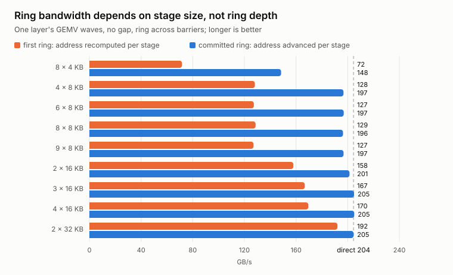
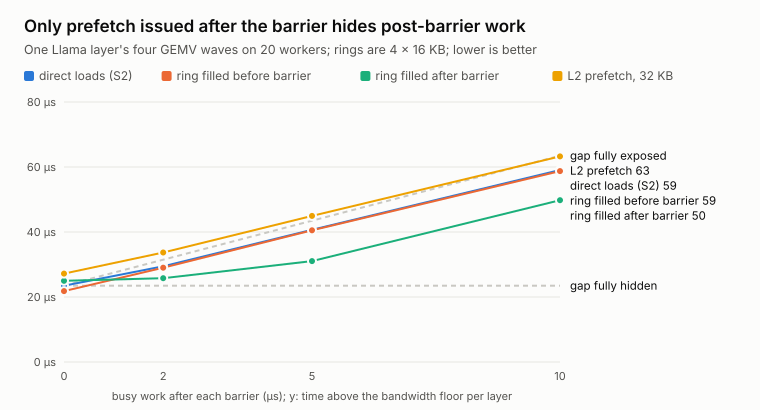

# Tiles S3: a weight ring that does not pay (yet)

Third status record for the blog series. It follows
[the S2 post](s2-fused-tasks-2026-10.md) and covers the first phase of
milestone S3 in [the megakernel plan](../megakernel_next_steps.md): a
microbenchmark that had to show weight prefetch across grid barriers was
worth building into the decoder. Everything here was measured on `tux` on
2026-10-23 with the probe from commits `16f412e` and `00a68b8`. Raw artifacts
are in `runs/s3-2026-10-23/`, and
[`make_s3_figures.py`](make_s3_figures.py) redraws the figures from them.

## In one paragraph

S2 left about 0.75 ms per token in GEMVs running below the bandwidth
roofline, and the plan blamed the grid barriers: after each one, every worker
starts its next weight stream from cold. Weights never depend on the token,
so S3 was to give each worker a shared-memory ring that keeps loading its
next task's weights while it waits at the barrier. A probe built on the
decoder's own launch shape says this does not work on the RTX 3050. **Weights
prefetched before a barrier hide none of the time lost around it.** The ring
itself costs nothing once each stage is cheap to issue, and its outputs stay
bit-identical to the decoder's row dot. Refilling the ring *after* the
barrier hides about half of whatever work follows the barrier, up to the
ring's 64 KB, and costs a little where nothing follows it. Projected onto
the decoder, that is at most about 0.1 ms per token, too little to justify
a new package format on its own. The plan
changes accordingly.

## What the probe measures

`bandwidth_probe ring` runs decoder GEMV shapes as *wave programs* on the
worker's cooperative launch: 20 blocks of 1,024 threads, one per SM, with a
grid barrier after every wave. Each worker projects an even share of every
wave's rows. Three programs cover the cases that matter:

| Program | Waves | Bytes per iteration | Iterations |
| --- | --- | ---: | ---: |
| layer | QKV (3,072 × 2,048), Wo (2,048 × 2,048), gate/up (16,384 × 2,048), down (2,048 × 8,192) | 121.6 MB | 16 |
| Wo chain | Wo only | 8.4 MB | 64 |
| `lm_head` | 128,256 × 2,048 | 525 MB | 2 |

After each barrier a worker can spin for 0, 2, 5, or 10 µs. The spin stands
in for the work S2 does between a barrier and its next weight load: the QKV
and gate/up norm prologues, the Wo gather of attention partials, or a short
attention wave.

Each program runs in five load modes:

| Mode | How a worker loads weights |
| --- | --- |
| direct | `ops::project_rows`, the S2 decoder's row dot, straight from global memory |
| ring, after work | `cp.async` ring, drained at task end, refilled when the next task starts streaming |
| ring, before barrier | the ring runs ahead into the next task while the current one finishes |
| ring, after barrier | drained at task end, refilled as soon as the barrier releases, before the spin |
| L2 prefetch | direct loads, after `prefetch.global.L2` of the next task's first 16–96 KB, issued before the barrier |

A ring stage holds one K-slice of 32 rows, one row per warp: 256 BF16
columns for a 16 KB stage. Each thread issues one 16-byte
`cuda::memcpy_async` per stage (`cp.async.cg`, `LDGSTS.E.BYPASS.128` in the
SASS), and a warp's 32 copies cover 512 contiguous bytes. The probe sweeps
nine geometries from 8 × 4 KB to 2 × 32 KB, reserving the decoder worker's
23,760 bytes of static shared memory so the L1/shared split matches.

Lane *l* still sums columns *l*, *l* + 32, … of its row in order, carrying
the accumulator from slice to slice. Every ring run is compared with
`project_rows` and matches it **bit for bit**. All three ring modes and
every geometry pass.

## Results

### The ring costs nothing — once each stage is cheap to issue



The first version was slower than direct loads in every configuration, from
72 GB/s with 4 KB stages to 191 GB/s with 32 KB stages. Ring depth made no
difference; only stage size did. The cause was instruction issue, not
memory. At 212.9 GB/s shared by 20 SMs, a 16 KB stage must arrive every
1.5 µs, about 2,800 cycles at the measured 1.82 GHz. In that time the SM's
four schedulers issue about 11,000 warp instructions, or roughly 350 per
thread for copying, waiting, and computing. The first version spent most of
that recomputing each copy's source address: a 64-bit division to place the
worker's rows, a modulo to find the wave, a reload of the wave descriptor.
The fits put the fixed cost at about 1,800 cycles per stage.

The committed version carries a per-thread source pointer that advances by
a constant per stage and does the divisions once per task. With 16 or
32 KB stages it then matches direct loads within noise (202–205 vs
205 GB/s on the layer program). 8 KB stages still lose 4%, and 4 KB stages
lose 28%. The decoder's 64 registers per thread suffice: the ring kernels
use 60–62, with no local memory.

### Prefetching before the barrier hides nothing



Time above the bandwidth floor for one layer (four waves, 571.3 µs ideal),
mean of two runs, rings of 4 × 16 KB:

| Busy work after each barrier | Direct | Ring, before barrier | Ring, after barrier | Ring, after work | L2 prefetch, 32 KB |
| ---: | ---: | ---: | ---: | ---: | ---: |
| 0 µs | 23.5 µs | 21.8 µs | 25.0 µs | 25.1 µs | 27.2 µs |
| 2 µs | 29.4 µs | 29.0 µs | **25.8 µs** | 32.8 µs | 33.7 µs |
| 5 µs | 40.7 µs | 40.5 µs | **31.0 µs** | 43.5 µs | 45.0 µs |
| 10 µs | 59.1 µs | 58.7 µs | **49.8 µs** | 62.1 µs | 63.3 µs |

Prefetching before the barrier, the S3 plan as written, tracks direct loads
at every gap. So does the L2 prefetch, which is also issued before the
barrier, and larger L2 prefetches only get worse: 96 KB per worker costs
16.5 µs per layer. A ring refilled after the post-barrier work, which is
what a straightforward pipelined GEMV does, costs 1.5–3.5 µs per layer for
its cold start.

Only the ring refilled right after the barrier hides anything. Against
direct loads it saves 3.6 µs per layer at 2 µs gaps and 9.3 µs at 10 µs
gaps, about 2.3 µs per barrier. That is about half of the most a 64 KB ring
can cover: 20 × 48 KB in flight is 4.5 µs of DRAM time. The Wo chain shows
the same pattern, saving 2.1 µs per wave at a 10 µs gap. Without a gap the
ring after the barrier is 1.5 µs per layer *slower* than direct loads.

### `lm_head` gains about 1%

`lm_head` is one 2.5 ms wave with no barrier inside. Direct loads reach
207.1 GB/s there. The ring with 2 × 32 KB stages reaches 209.4 GB/s
(−28 µs), and 3 × 16 KB reaches 208.6–208.9 GB/s (−19 to −22 µs); every
mode of filling it does equally well. The L2 prefetch is neutral.

## Why prefetch before a barrier cannot work here

S0 measured that 8 of the 20 workers saturate DRAM. In a wave, workers
finish at different times, but until the last few are done the remaining
ones still saturate the bus. Bytes that an early finisher prefetches for its
next task are taken from the stragglers' share, so the wave does not end
sooner. By the time the last worker reaches the barrier, every other
worker's prefetch has long landed, and only the ring's capacity at most
remains in flight. Barrier latency, the post-barrier work, and the
pipeline's restart all fall into a window in which DRAM idles, whatever was
prefetched before it.

Prefetch helps only when it is issued *into* that window: after the barrier
releases and before the worker turns to non-streaming work. Even then it is
capped by what fits in shared memory. With about 75 KB free per SM, the
whole GPU can hold some 1.5 MB, about 7 µs of DRAM time, and the measured
ring hides about a third of that. L2 would hold more, but this GPU has 2 MB
of it, and the probe found no benefit from L2 prefetch issued before the
barrier. An L2 prefetch issued after the barrier is untested.

## What this says about S2's remaining 1.3 ms

At context 1, S2 takes 12.90 ms against an 11.61 ms floor. The probe splits
the GEMV part of that gap more finely than the S2 budget could:

| Loss | Per token | Evidence |
| --- | ---: | --- |
| Steady-state streaming below the roofline | about 0.32 ms | `lm_head`, one long wave, streams at 207.1 of 212.9 GB/s: 2.7% of the 11.61 ms floor |
| Wave boundaries and prologues | about 0.40 ms | the rest of the 0.72 ms GEMV excess; the layer program loses about 2 µs per wave beyond the steady-state rate |
| Attention | 0.42 ms | S2 trace budget |
| Barrier latency | 0.13 ms | S2 trace budget |

The steady-state and boundary rows are estimates from the probe, not a
decoder trace. Prefetch after the barrier attacks only part of the
boundary row. Per S2 layer, it could hide about half of the QKV and gate/up
norm prologues (each 1–2 µs, about 1 µs saved per wave) and up to 2.3 µs of
the attention waves ahead of Wo, while the down wave, which has no prologue,
would lose about 0.4 µs. That is about 4 µs per layer, 0.06 ms per token;
with the ring's `lm_head` gain of 0.02–0.03 ms, at most about 0.1 ms.

## What changes in the plan

1. **The ring is not built as its own milestone.** Its best case does not
   pay for a new package format, a dynamic shared-memory carveout, and a
   second GEMV path. The probe and its numbers stay. If the GEMV loop is
   rewritten anyway (S4), the ring comes along with 4 × 16 KB stages and is
   refilled right after each wait, where a counter wait makes "issue, then
   wait" natural.
2. **Short-context attention moves up** as the new S2b. It is the largest
   single loss at contexts up to 1K (0.42 ms at context 64), and it needs no
   new synchronization.
3. **Fewer wave boundaries over faster ones.** Each removed boundary is
   worth about 2–3 µs. Fusing gate/up with a split-K down per worker, and
   splitting Wo by K/V group behind attention, removes boundaries instead
   of hiding them.
4. **Every milestone now starts with a probe.** This one took a few hours
   and saved a package-format change for at most 0.1 ms.

The revised plan is in
[the megakernel plan](../megakernel_next_steps.md#5-milestones).

## How these numbers were produced

From `tux:~/dev/tiles` at `00a68b8`:

```sh
cmake --build tileinfer/build/release --target bandwidth_probe
tileinfer/build/release/bandwidth_probe ring > runs/s3-2026-10-23/ring-1.json
tileinfer/build/release/bandwidth_probe ring > runs/s3-2026-10-23/ring-2.json
uv run --locked --project tileplan python docs/blog/make_s3_figures.py \
  runs/s3-2026-10-23 docs/blog/figures
```

Each configuration runs once to warm up and three times timed; the JSON
holds the median, and the tables and figures average the two runs, which
agree to within about 2 µs per layer. `ring-v1-*.json` came from the first
version of the probe, which differed only in how the ring placed each copy;
it was not committed. The spin gaps are calibrated in SM cycles (1,822
cycles per µs). Clocks were unlocked. These are exploratory timings on a
synthetic program built from the decoder's shapes and launch, not decoder
measurements.
