# Next steps: a tile-graph megakernel that beats CUDA Graph replay

Status: proposal, 2026-10-22. Written from the committed local tree
(`fa4f46f`) and the uncommitted result documents
([BF16 computation results](bf16_compute_results.md),
[quality implementation](tileinfer_quality_implementation.md),
[code review](tileinfer_code_review.md),
[refactoring plan](tileinfer_refactoring.md)). `tux` was unreachable while
this was written, so no number below was re-measured. Values marked
*estimate* are arithmetic from the model shape and the committed planner.
They are not measurements.

**Progress, 2026-10-23: the Section 3 cleanup, S1, S0 and S2 are done.**
[Section 8](#8-cleanup-and-s1-results) covers the cleanup and S1;
[Section 9](#9-s0-results-where-the-time-goes) has the S0 measurements, which
replace several estimates in Sections 1 and 2 (each marked **S0 measured**).
S2 is written up in [the S2 post](blog/s2-fused-tasks-2026-10.md):
TileInfer now matches CUDA Graph replay at context 1 and beats it by up to
15% at 4K.

**Re-plan, 2026-10-23: S3's probe came back negative.** Weights prefetched
before a grid barrier hide none of the time lost around it; refilled right
after the barrier, a 64 KB ring hides about half of the work that follows,
which projects to at most 0.1 ms per token
([Section 10](#10-s3-probe-results-and-the-re-plan),
[the S3 post](blog/s3-weight-prefetch-2026-10.md)). The ring is not built
into the decoder. The milestones in [Section 5](#5-milestones) are revised:
next is **S2b, short-context attention**, then **S4, fewer wave
boundaries**, and every milestone now opens with a probe gate.

**Re-plan, 2026-10-25: the S2b probe found a bigger problem than planned.**
The S2b gate passed, but its diagnosis was wrong. Attention at short context
is a chain of dependent global-memory round trips per task, and at long
context it is a one-row-in-flight K/V loop that reaches 25 GB/s of 213. A
`attention_probe` replacement with 16-byte loads and one task per block is
3.7 times faster at 4K and 2.8 to 3.7 times faster at context 1 to 256, which
projects to 0.3 ms per token at context 1 and 3.9 ms at 4K
([Section 11](#11-s2b-probe-results-attention-at-the-right-parallelism)).
S2b now covers both ends of the context range and stays first in line.

**Progress, 2026-10-25: S2b is done.** Attention runs as one fused task per
K/V head up to 384 steps and as two wide chunk tasks beyond, with the barrier
between the attention waves skipped while it is fused. TileInfer is now faster
than CUDA Graph replay at every measured context: 12.32 against 12.85 ms at
context 1 (−4%) and 13.16 against 20.31 ms at 4K (−35%)
([Section 12](#12-s2b-results)). One checkpoint step flips greedy selection on
a one-unit BF16 near-tie; every calibrated tolerance passes.

**Re-plan, 2026-10-25: S4 was sized on S2's numbers.** After S2b the
context-1 loss is 0.71 ms, and the largest part of it is not a wave boundary.
Each QKV task owns one whole head, so 48 tasks fall on 20 workers in rounds
of 3 and 2. QKV loses 203 µs, 138 µs of it waiting for the last worker. The
steady-state shortfall is about 0.18 ms, not 0.32, so S4 can remove at most
about 0.15 ms. The order is now: **S6a, a controlled measurement protocol**,
because S4's 0.1 ms gate is within the spread of the exploratory timings;
**S2c, a balanced QKV**, with RoPE and the K cache write moved into the
attention task; and then a smaller **S4**
([Section 13](#13-the-re-plan-after-s2b)).

**Progress, 2026-10-26: S2c is done, ahead of S6a.** QKV rows split evenly
over the workers, and each K/V head's attention task applies RoPE. Outputs
are bit-identical to S2b. The traced token is 0.10 to 0.13 ms faster at every
context, untraced fixed-context calls 0.05 to 0.08 ms, and 64-token
generation 0.10 ms (0.8%), each against S2b in the same session
([Section 14](#14-s2c-results)). S6a still comes before S4.

The goal is a prototype that **shows what a tile-based megakernel can do**.
Running correctly in one launch is already done. The prototype should show a
measured, explained advantage over PyTorch CUDA Graph replay on the same
RTX 3050, using the same checkpoint and numerical policy.

## 1. Where the project stands

The reported BF16 results (policy `hf-llama-eager-bf16-v1`, SIMT row-dot,
tile 64, 20 workers × 1024 threads, one cooperative launch per token):

| Measurement | TileInfer | PyTorch eager | PyTorch graph |
| --- | ---: | ---: | ---: |
| Fixed context 1, ms | 12.99 | 14.09 | 12.88 |
| Fixed context 64, ms | 13.18 | 14.42 | 13.05 |
| Fixed context 256, ms | 13.84 | 14.89 | 13.41 |
| Generation (6-token prompt, 2 new), ms/token | 13.158 | 14.247 | 12.978 |

TileInfer is already faster than eager. It is 1–3% behind graph replay, and
the gap grows with context (+0.85 ms from context 1 to 256, versus +0.53 ms
for graph replay).

### The roofline frames everything

Batch-one decode reads every weight once per token and does about one FMA per
weight byte pair. On this GPU it is limited by memory bandwidth, not by
arithmetic.

| Quantity | Value |
| --- | ---: |
| BF16 weight bytes read per token (16 layers + tied `lm_head`) | 2,471,628,800 |
| of which `lm_head` | 525,336,576 (21%) |
| per layer: QKV / Wo / gate+up / down | 12.6 / 8.4 / 67.1 / 33.6 MB |
| BF16 K/V bytes read per token at context T | 32,768 × T (134 MB at 4K) |
| Nominal DRAM bandwidth (128-bit, 14 Gbps GDDR6) | 224 GB/s |
| Bandwidth floor, weights only | 11.0 ms |
| Graph replay at 12.98 ms | ≈ 190 GB/s, 85% of nominal |
| TileInfer at 13.16 ms | ≈ 188 GB/s, 84% of nominal |

A streaming-read kernel usually reaches about 90–93% of nominal bandwidth. If
that holds here, the realistic floor is **about 12.0 ms/token** *(estimate)*.
That leaves graph replay roughly 1 ms (7–8%) of headroom at short context.

**S0 measured:** a streaming read reaches **212.9 GB/s** (95% of nominal), so
the weight-only floor is **11.61 ms/token**. Graph replay at context 1
(12.84 ms) is 1.23 ms above it; TileInfer (13.03 ms worker + 0.17 ms argmax)
is 1.58 ms above it.

Three conclusions follow:

1. **Faster arithmetic will not help.** This is why native BF16 MMA did not
   help: the reported MMA path is 2.15× slower because of how it loads data,
   and the tensor cores have nothing to speed up at batch one.
2. **Scheduling only matters as far as it keeps DRAM busy.** The schedule's
   job is to make every microsecond of the token stream weight bytes at full
   bandwidth. The causes of idle DRAM are barriers, unbalanced waves, serial
   small phases, and attention.
3. **The claim we can show is "no bubbles", not "fewer FLOPs".** At short
   context, an honest target is about 5–8% faster than graph replay. At long
   context the target is larger (Section 2.5).

## 2. Where the remaining ~1.2 ms probably goes

These are hypotheses ranked by the estimated size of their effect. Milestone
S0 measures each of them before anything changes.

### 2.1 Wave quantization (largest suspect)

The planner splits each GEMV into fixed 64-row tiles and assigns them per
wave to 20 workers. Most projections do not divide evenly:

| Wave | Tasks (tile 64) | Rounds on 20 workers | Slot utilization |
| --- | ---: | ---: | ---: |
| Q+K+V | 32+8+8 = 48 | 3 | 80% |
| Wo | 32 | 2 | 80% |
| gate+up | 256 | 13 | 98% |
| down (64 × 8192 tiles) | 32 | 2 | 80% |
| attention heads | 32 | 2 | 80% |

Suppose each SM had a fixed share of bandwidth. Then this layout would make
each layer cost about 136 MB worth of time for 122 MB of bytes. That is up to
**12% (about 1.5 ms/token)** *(upper-bound estimate)*. The real cost is lower,
because busy SMs can pull more than 1/20 of DRAM bandwidth while others sit
idle. How much more depends on how many bytes each SM keeps in flight. The
device trace in S0 measures the actual cost.

**S0 measured:** small. One worker streams about 30 GB/s and 8 workers already
saturate DRAM, so a second or third round with 8–12 busy workers still runs
near full bandwidth. The 64-row tiles cost at most 3.5% against an even split
per GEMV. QKV and Wo waves achieve 180 GB/s and down 196 GB/s in the decoder.

### 2.2 Grid barriers

The committed planner produces 9 waves per layer: norm, QKV, RoPE/cache,
attention, Wo, norm, gate/up, SiLU, down. Each wave ends with a
`grid.sync()`. Adding embedding and final norm gives about **146 grid barriers
per token**. At 2–5 µs each, including the tail of the slowest worker, that is
0.3–0.7 ms *(estimate)*. During a barrier no worker issues weight loads.

**S0 measured:** an empty wave costs 0.79 µs. In the decoder the latency from
the last arrival to release is 0.13–0.16 ms per token, about 1 µs per barrier.

### 2.3 Serial low-bandwidth phases

Norm, RoPE/cache, SiLU/product, embedding, final norm, and the argmax kernel
move almost no bytes. They still cost a wave each, plus a barrier. In the
committed source, `rms_norm` and `final_norm` sum squares serially on thread 0.
In `final_norm`, every block repeats that sum. The tux tree has a
PyTorch-order block reduction for BF16. Greedy selection is a separate kernel
launch per token.

**S0 measured:** 0.40 ms per token inside the worker (SiLU 0.22 ms, the two
norms 0.15 ms, RoPE 0.08 ms) plus **0.165 ms for the greedy-selection kernel**,
which scans all 128,256 logits with one 256-thread block.

### 2.4 Per-SM memory-level parallelism

How well wave tails are hidden depends on how many outstanding bytes one SM
can sustain. That depends on vector width, unrolling, and whether loads are
asynchronous. Little's law at about 224 GB/s and about 0.5–0.6 µs latency
calls for roughly 120–130 KB in flight across the GPU, or about 6 KB per SM
when all 20 are busy. When only 8 SMs are busy, each needs about 16 KB.
Measure the row-dot routine alone (Section S0). That separates kernel
efficiency from scheduling.

**S0 measured:** the row-dot routine reaches 192–210 GB/s with 20 workers and
about 30 GB/s with one. Its 2-byte loads are enough in this access pattern; a
plain grid-stride stream of 2-byte loads reaches only 124 GB/s.

### 2.5 Attention at long context (not yet measured)

Measurements stop at context 256, where K/V traffic is 8 MB/token. At 4K it is
134 MB/token, 5% of the weight bytes. The current mapping is one task per
query head, which means:

- 32 tasks on 20 workers, so a second round with 12 idle workers;
- each KV head read up to 4 times (GQA group of 4), unless L2 (about 2 MB)
  catches the reuse;
- one SM streaming a whole head's prefix at single-SM bandwidth.

*Estimate:* about 1.5 ms/token at 4K, against an ideal of about 0.65 ms.
Hugging Face eager attention in the baseline also materializes `repeat_kv`.
That writes and then reads 4× expanded K/V, on the order of 1 GB of extra
traffic per token at 4K *(estimate; it depends on the static-cache
configuration)*. Graph replay therefore likely degrades faster than
TileInfer. If so, long context is where the megakernel
can show a clear win. Report it honestly as a win against *eager-attention*
PyTorch (Section 6).

**S0 measured, and the prediction was wrong.** Attention costs 0.25 ms at
context 64, 2.4 ms at 1K, and **9.4 ms at 4K**, where it reaches only
14 GB/s against 0.63 ms of unique K/V bytes. Graph replay degrades less: from
context 1 to 4K it gains 7.5 ms per token, TileInfer 9.3 ms. TileInfer is
slower than graph replay at every measured context.

## 3. Is a code/architecture cleanup needed?

**Yes, but a narrow one. Do not do a broad refactor.** The architecture is
sound for the goal. The Python offline planner, the C++ structural validator
and encoder, a single cooperative worker, and an immutable model plus mutable
`SequenceContext` are the right boundaries for a megakernel. The cleanup that
matters is the cleanup that unblocks scheduling work.

### Do first (these gate the scheduling work)

1. **Land the tux working tree.** *(Correction: this work was already
   committed and pushed as `60ff850`; the local checkout used for this
   proposal was seven commits behind. Only the paired-vector `warp_dot`
   experiment was uncommitted on tux; it is parked on the local tux branch
   `experiment/vector-warp-dot`.)* Every later ablation is measured against
   `60ff850`.
2. **Narrow the performance variants.**
   - Remove the native-MMA decode variant from the worker. Keep its
     description and probe results in the docs as a prefill candidate. It is
     2.15× slower, and it doubles the cases the probe and sanitizers must
     cover.
   - Keep the pure-float32 policy as a precision reference that is tested but
     never tuned. The probe already takes the minimum occupancy across
     variants, so a resource-heavy reference variant can limit the BF16
     worker. Consider building it only into `tile_runtime_test`.
   - When the version-5 ABI arrives (S1), stop reading packages in versions
     2 and 3. Regenerating a package is cheap, and every legacy reader adds
     validation surface.
3. **Make the device program the whole token.** Today the kernel hard-codes
   the phases: embedding, a layer loop over a repeated block template, final
   norm, logits. Argmax is a separate launch. Wave boundaries are implicit in
   the `Range[wave × workers + block]` table. Scheduling work needs three
   changes:
   - a **flat, per-worker instruction stream** covering all layers;
   - every phase as an opcode (`embed`, `norm_stats`, `logits_tile`,
     `argmax_partial`, ...);
   - explicit synchronization **instructions** (`barrier`, later
     `wait counter ≥ n` / `signal counter`).

   This is the cleanup and the scheduling enabler in one change. It is
   milestone S1.

### Do alongside, when touching the same code

- Review finding 2 (NaN/INT_MAX greedy selection). It goes away when argmax
  moves into the worker in S5. Design the device error status then.
- Review finding 3 (throwing destructors). This is a small fix. Do it before
  adding spin-wait code, because a hung or failed kernel must produce a
  clean error.
- Rename `Range` to `WorkerTaskRange`, or retire it with the v5 program.

### Defer (not on the per-token critical path)

- The pinned input ring and ticket-state split in
  [the refactoring plan](tileinfer_refactoring.md). `generate` enqueues a whole
  request with no per-token host work, so host enqueue cost cannot affect
  ms/token. Do it when serving or streaming becomes a goal.
- Review finding 4 (dropped EOS ticket). This is an API lifecycle issue,
  unrelated to the megakernel claim.

## 4. Scheduling direction

### The central idea: weight streaming has no data dependencies

In batch-one decode, nearly every dependency is dense. Every row of every
projection reads the whole input vector, and RMSNorm needs the whole
residual. A tile graph therefore cannot start much *computation* early:
`QKV ← x`, `Wo ← all heads`, `gate/up ← r`, `down ← all of SiLU·up` are
inherently all-to-all.

What *can* start early is loading the weights. A weight tile never depends on
the token. Split each GEMV tile into two graph nodes:

```text
load(W tile → shared memory)    predecessors: none (only buffer-slot reuse)
compute(tile)                   predecessors: input-vector producers, load(W tile)
```

With that split, the 9–10 µs that 20 × ~96 KB of shared memory holds at full
bandwidth covers a barrier, a norm, a RoPE step, a short attention, or a layer
boundary. DRAM keeps streaming while dependencies resolve.

This is a capability that graph replay **lacks on this GPU**. Programmatic
dependent launch, which lets kernel N+1 start loading while kernel N drains,
requires compute capability 9.0. The RTX 3050 is 8.6. It is the clearest
mechanism the prototype can demonstrate.

> **S3 probe:** the idea above fails on this GPU when the load is issued
> *before* the barrier. DRAM stays saturated until the slowest worker
> finishes, so an early worker's prefetch only takes bandwidth from the
> stragglers, and it has landed long before the barrier releases. Loads
> issued *after* the barrier, into the window where DRAM idles, do overlap
> the post-barrier work, but only up to the ring's capacity (about 7 µs of
> DRAM time for the whole GPU). See
> [Section 10](#10-s3-probe-results-and-the-re-plan).

### Why static assignment beats a dynamic queue here

A worker can prefetch the weights for its next task only if it knows which
task comes next. A static per-worker instruction stream, produced by the
planner, makes prefetch trivially correct and deterministic. A global atomic
work queue would balance load automatically but destroy prefetch: a worker
does not know its next tile until it claims it. This supports the project's
"offline planner, static schedule" thesis. Keep a dynamic queue as an
*ablation* (S4), not as the design.

Use static *assignment* with dynamic *timing*. The order on each worker is
fixed. Waits on dependency counters replace global barriers, so a worker
proceeds as soon as its own inputs are ready.

### Partial dependencies worth exposing

These are where the tile graph does let computation start early:

```mermaid
flowchart LR
    X[x / residual] -->|all rows| QKV[QKV tiles + norm scale + RoPE + cache write]
    QKV -->|per KV head| ATT[attention chunks, per KV head × context chunk]
    ATT -->|per head| COMB[softmax combine per head]
    COMB -->|per head columns| WO[Wo split-K partials]
    WO -->|all partials| R[r = x + Wo·a, norm stats]
    R -->|all rows| GU[gate/up interleaved tiles + SiLU·up]
    GU -->|per column chunk| DN[down split-K partials]
    DN -->|all partials| X2[next layer x, norm stats]
```



- **QKV → attention, per KV head.** Attention for a KV head group can start
  as soon as that group's Q, K, and V rows exist. Today it waits for all QKV
  tiles and a separate RoPE wave.
- **Attention → Wo, split-K by head.** A Wo partial over head `h`'s columns
  needs only head `h`.
- **gate/up → down, split-K by column chunk.** A down partial over product
  chunk `k` needs only gate/up tile `k`.
- **Norm statistics produced by the producers.** Each Wo or down reducer can
  emit the partial sum of squares for its rows. Consumers combine the 20
  partials in a fixed order and apply the scale while loading `x`. This
  removes the norm tasks and their barriers entirely.

To keep results deterministic, split-K partials go to an FP32 partial buffer
and are reduced in a fixed order. Do not use float `atomicAdd`. The BF16
policy's "round the projection before the residual" boundary is applied after
that reduction. Summation order changes against the unsplit row-dot, so the
existing calibrated tolerances apply, not bit equality.

## 5. Milestones

Each milestone keeps the decoder reference and checkpoint regressions green,
reprobes the compiled worker, and runs clang-format, Ruff, ty, CTest, and
Compute Sanitizer before any timing is reported (AGENTS.md). Each one adds a
row to the ablation table in S6.

**Every milestone opens with a probe gate** (added after S3). Before the
package format or the worker changes, a microbenchmark on the worker's own
launch shape (`bandwidth_probe`, the operator unit harness, or the timeline
trace) must show that the mechanism recovers its expected share of time.
The gate states its threshold up front. Below it, the milestone is
re-planned instead of built.

Order after the re-plan of 2026-10-25: S0, S1, S2 (done) → S3 (probed, not
built) → S2b attention at the right parallelism (done) → **S6a** controlled
measurement protocol → **S2c** balanced QKV (done first, 2026-10-26) → **S4**
fewer wave boundaries → S5 one launch per request → S6 showcase.

### S0 — Baseline and instruments (no kernel behavior change) — done

Results are in [Section 9](#9-s0-results-where-the-time-goes).

- Land the tux tree (Section 3) and tag the baseline.
- **Bandwidth roofline.** Add a test-only streaming kernel that reads the
  package's weight blob in tile order, with the same 20 × 1024 launch, and in
  the best configuration found. Report attainable GB/s. This replaces the
  "~12.0 ms" estimate with a measured floor.
- **Row-dot microbenchmark.** Time each GEMV shape (QKV, Wo, gate/up, down,
  `lm_head`) alone across all 20 workers and on k = 1…20 active workers. This
  measures per-SM bandwidth and settles how much of Section 2.1 is real.
- **Device timeline trace.** Optional, runtime-enabled, off when timing. For
  each instruction, thread 0 writes `{task, worker, start, end}` using
  `%globaltimer` (check its update resolution on this part, and fall back to
  `clock64` deltas plus one alignment point per worker). It also records time
  spent waiting at each barrier. Render it with the existing
  `tileplan visualize`/`tile_flow` code as a per-worker Gantt chart, with
  bytes per task. This chart is both the main diagnostic and the main showcase
  figure.
- **Extend the context axis.** Use contexts 1, 256, 1024, 2048, and 4096 with
  a 4K-capacity package, for TileInfer and both PyTorch paths.
- Report the **bubble budget**: measured time minus bytes ÷ attainable
  bandwidth, split into barrier wait, wave tails, small phases, attention, and
  `lm_head`/argmax.

*Done when* the per-token time is explained to within about 0.2 ms by named
components.

### S1 — Version-5 program ABI (cleanup, no change in behavior)

- The planner emits one flat program for the whole token: embedding, all
  layers, final norm, `lm_head` tiles. Each worker gets an ordered instruction
  list. Waves become explicit `barrier` instructions on every worker.
- The C++ validator checks the existing structure. It also checks that all
  workers have the same barrier count and that, for any later counter waits,
  every wait names producers with a strictly smaller global topological index
  (see S4).
- The kernel becomes `for (instr : my_stream) dispatch(instr)` with no
  hard-coded phases. Drop version-2/3 readers and the MMA decode variant.

*Acceptance:* logits, K/V, and block outputs are **bit-identical** to the
S0 baseline for float32 and BF16. The arithmetic and order do not change, so
any difference is a bug. Timing should be unchanged within noise.

### S2 — Fewer, better-balanced waves (still barriers) — done

Implemented as fused QKV/gate-up tasks, context-chunked attention, even row
splits instead of tiles, and a faster argmax; results and what did not go as
hoped are in [the S2 post](blog/s2-fused-tasks-2026-10.md).

- **Byte-balanced tiles.** For each GEMV, split rows (or K) into exactly
  `k × workers` near-equal ranges. Concatenate Q, K, and V into one
  3,072-row stage. Interleave gate and up rows, so SiLU·up happens in the
  epilogue of the same tile. The planner's cost becomes *bytes*, not
  `estimated_work = rows × width`.
- **Fuse the small phases into epilogues or prologues:**
  - RMSNorm: each consumer recomputes the 2,048-element statistic (4 KB, in
    the fixed PyTorch reduction order) or reads producer partials.
  - RoPE and cache write: in the QKV tile epilogue when the tile owns whole
    heads.
  - SiLU/product: in the gate/up epilogue.

  The target is 4 barriers per layer instead of 9. Every fusion must keep the
  rounding boundaries in the [BF16 plan](bf16_compute_plan.md). The operator
  unit tests already pin them.
- **GQA-grouped, context-split attention** (flash-decoding style). Each task
  handles one KV head × one context chunk for all 4 query heads of the group.
  A combine step per head follows. Choose the chunk count so the task count
  is a multiple of 20 at long context. Keep the explicit eager-softmax
  rounding contract. See [Flash-Decoding](https://crfm.stanford.edu/2023/10/12/flashdecoding.html).

*Expected:* most of 2.1–2.3 and 2.5 are recovered without any new
synchronization protocol. This alone may reach parity or better at short
context.

### S3 — Weight prefetch across synchronization — probed, not built

The plan was a per-worker shared-memory ring of weight stages, filled with
`cuda::memcpy_async`, that keeps loading the next task's weights while the
worker waits at a barrier. Phase 1 built it in `bandwidth_probe ring` on
decoder GEMV shapes and the worker's launch (commits `16f412e`, `00a68b8`).

- The ring keeps `project_rows`' per-lane summation order: outputs are
  bit-identical in every mode and geometry.
- With 16–32 KB stages it streams as fast as direct loads. Smaller stages
  lose, because per-stage instruction overhead, not memory, sets the pace.
- **Filled before the barrier, it hides none of the post-barrier time**, nor
  does an L2 prefetch issued there.
- Refilled right after the barrier, 4 × 16 KB hides about 2.3 µs per barrier
  when 5–10 µs of work follows, and costs 0.4 µs per wave when none does.
- `lm_head`, one long wave, gains about 1% (2 × 32 KB stages).

Projected onto the decoder, that is at most 0.1 ms per token. The gate
failed, so the ring stays a probe. Its after-barrier form (4 × 16 KB, refill
right after each wait) is folded into S4's GEMV rewrite. Details are in
[Section 10](#10-s3-probe-results-and-the-re-plan) and
[the S3 post](blog/s3-weight-prefetch-2026-10.md).

### S2b — Attention at the right parallelism — done

Implemented as planned below, with one change to the chunk rule: a prefix
runs fused only up to 384 steps, and longer ones use at least two chunks,
because the probe found two half-length tasks faster beyond that. Results,
including a code-size regression that had to be fixed, are in
[Section 12](#12-s2b-results).

S2's attention costs 0.42 ms per token above ideal at contexts 1–64 and
4.1 ms at 4K, in 40 chunk tasks per wave on 20 workers. The probe in
[Section 11](#11-s2b-probe-results-attention-at-the-right-parallelism)
replaced the original diagnosis (block reductions per query head) with two
others:

- **Short context is a chain of dependent global round trips per task**, not
  reduction arithmetic. Each task loads `q` and K, stores scores, reloads
  them for the statistics, stores the statistics, and the values task reloads
  those. That is about 7 µs per task (inferred from 15 µs per wave of two
  tasks), and 40 tasks on 20 workers run two in a row. The warp reductions
  in the dot products cost only 1 µs per layer.
- **Long context is memory-level parallelism.** The K loop keeps one 128-byte
  row in flight per warp with two dependent 2-byte-strided loads each (about
  3 µs per row, derived from the K-only loop), so the 4K waves reach
  25 GB/s. The K/V layout is not the cause: a pure row-read kernel with
  16-byte loads reaches 169 GB/s on the same layout.

- **Probe gate: passed.** Fixed per-task overhead outside K/V reads and grid
  barriers is 22 µs per layer at context 1, 0.36 ms per token against the
  0.2 ms threshold (0.3 ms after discounting the instrumentation's 15%).
- **Wide K/V loads.** A lane loads 16 bytes, a warp loads four rows per
  instruction, and four loads are in flight per lane. `q` stays in registers
  as packed BF16 and one warp reduces each query head's statistics.
- **One task per worker.** Tasks per wave are `kv_heads × chunks`, and the
  planner's rule (the fewest chunks that balance 20 workers, 5) put two
  serial tasks on every worker. Use the fewest chunks that make a task fit
  in shared memory: 1 up to 2,048 steps, 2 up to 4,096. Eight workers
  already pull 170 GB/s with wide loads.
- **A fused single-wave task.** When the prefix fits one chunk, the task keeps
  scores and probabilities in shared memory, finishes the softmax and P·V
  itself, and the barrier between the two attention waves is skipped.
  Every worker evaluates the same `position`, so the skip is uniform. The
  instruction carries the threshold, and the validator checks both paths.
- **Numerics.** Scores and probabilities still round to BF16 at the eager
  points. The FP32 summation order changes (8-lane dot trees, per-lane P·V
  accumulation, the warp-level statistics), so outputs match S2 up to
  rounding, not bitwise. The probe's worst difference is 2.9e-6 in the FP32
  attention vector. The decoder regression and the checkpoint tolerances must
  pass unchanged before any timing counts.

*Expected (hypothesis, from the probe):* attention above ideal falls by 0.3 ms
per token at context 1, 0.7 ms at 256, 1.1 ms at 1K, 1.6 ms at 2K and 3.9 ms
at 4K. That puts TileInfer at about 12.6 ms at context 1, 12.7 ms at 1K and
13.3 ms at 4K.

### S6a — Controlled measurement protocol (moved forward from S6)

Every timing so far is exploratory: unlocked clocks, one session, no stated
minimum detectable difference. That was enough while each milestone moved the
token by 0.5 ms or more. S2c and S4 each aim at about 0.1 ms, 0.8% of a
token, which is inside the spread already seen (short-context probe sweeps
differ by up to 10%, rtbench passes by 0.5%). Their gates cannot be judged
without this step.

- **Fix the GPU state.** Lock the SM and memory clocks where the driver
  allows it, and record them with temperature and power for every run. If a
  clock cannot be locked, say so and rely on interleaving.
- **Measure the noise.** Run the same binary and package against itself (A/A)
  at contexts 1, 256, 1K and 4K, interleaved, in several sessions. Report the
  spread and the smallest difference the protocol detects in ms per token.
  Each later gate states its threshold against that number.
- **Freeze the S2b headline.** Rerun the context sweep of
  [Section 12](#12-s2b-results) against PyTorch eager and graph replay under
  the protocol of [Section 6](#6-measurement-and-honesty-rules-for-the-showcase-claim).
  The −4% at context 1 and −35% at 4K become controlled numbers or are
  corrected.
- **Rerun the runtime comparison.** Its Phase 2 table
  ([runtime comparison](runtime_comparison_plan.md)) still has S2's TileInfer
  (17.2 ms at 4K, behind llama.cpp's 14.3 ms). Rerun it with S2b in the same
  harness.

*Done when* the A/A spread is stated, it is below the 0.08 ms S2c threshold
(otherwise S2c and S4 are judged on their probes and the trace only, and the
write-up says so), and the S2b and llama.cpp rows are controlled.

### S2c — Balanced QKV — done

Implemented as planned below, before S6a, with one change: chunk 0, not the
task whose chunk holds the current position, writes the rotated K cache row,
and that task takes the row from shared memory instead. Which chunk ends at
the current position depends on the position; chunk 0 is the same at every
position, so the validator checks one writer. Results are in
[Section 14](#14-s2c-results).

After S2b, QKV is the largest single loss at context 1: 1,167 µs against
946 µs ideal, at 172 GB/s, while the other projections stream at 192 to
207 GB/s. Its tasks own one whole head each, so that RoPE and the cache write
fit in the task (`plan_core.py`), which puts 48 tasks on 20 workers: 8 workers
run 3 heads, 12 run 2. The last worker finishes 138 µs per token after the
average one, 8.6 µs per wave ([Section 13](#13-the-re-plan-after-s2b)).

The 3/2 split alone does not explain that: S0's row-dot probe measured only
2.2 µs per QKV GEMV between 64-row tiles and an even split. Each head task
also repeats the norm prologue (`normalize` over the 2,048-element input)
and runs a pipeline of two rows per warp, and the 3-task workers pay both
once more. Moving the work out of the head task removes both.

- **Probe gate.** In `bandwidth_probe`, run the QKV wave of 16 layers as
  head tasks with the per-task norm and RoPE epilogue, against one even row
  range per worker with one norm. Go if the even split saves at least 5 µs
  per layer (0.08 ms per token) and S6a can detect that.
- **Even rows.** Split the 3,072 rows of `[Q; K; V]` into 20 near-equal
  ranges with one norm prologue per worker. Q and K rows go, rounded to the
  storage type as today, into a pre-RoPE scratch vector; V rows go straight
  into the value cache.
- **RoPE in the attention task.** The attention task of K/V head *g* already
  owns its four query heads and is the only reader of K row *g* at the
  current position. It rotates its query heads into registers or shared
  memory, and the task whose chunk holds the current position rotates K and
  writes the cache row before reading it. That is 5 × 64 elements per task,
  against a fused task of about 6 µs.
- **Validator.** It models the scratch vector and the K row written inside
  the attention task, in the fused and the split regime, and rejects a split
  that reads the current K row from any other chunk.
- **Numerics.** The projection rounds before RoPE today, and `rotate_pair`
  reads that rounded value, so the arithmetic is unchanged. *Acceptance:*
  logits, K/V and block outputs **bit-identical** to S2b for float32 and
  BF16, as in S1. Any difference is a bug.

*Expected (hypothesis):* 0.05–0.13 ms per token at every context, most of
the 138 µs of waiting for the last worker, minus what the attention task
gains.

### S4 — Fewer wave boundaries: fused FFN, split-K, dataflow counters

*Re-scoped 2026-10-25* ([Section 13](#13-the-re-plan-after-s2b)). The S3
probe split S2's 0.72 ms of GEMV excess at context 1 into about 0.32 ms of
steady-state streaming below the roofline and about 0.40 ms at wave
boundaries and in prologues. After S2b, GEMV excess is 0.49 ms and `lm_head`
streams at 209.6 GB/s, so the steady-state part is about 0.18 ms. Barrier
latency is 0.11 ms, in about 82 barriers (fused attention skips 16). At
long context, attention now loses 0.28 ms, not 4 ms, so overlapping Wo with
attention is worth little there.

S4 removes three of the five barriers per layer: gate/up → down, QKV →
attention and attention → Wo. The hard synchronizations after Wo (`r`) and
after the FFN (`y`) stay. At about 1.3 µs of barrier latency plus about 2 µs
of pipeline ramp per boundary, that is at most about 0.15 ms per token.

- **Probe gate.** Extend `bandwidth_probe`'s layer program with the
  candidate structure before touching the decoder, measured against S2c:
  first the fused FFN alone, then counter waits in place of `grid.sync()`
  around attention. The fused FFN's gate includes the cost it moves into the
  next QKV prologue. Go for each part if it saves at least 0.06 ms per token
  and S6a can detect that.
- **Fused FFN per worker (first).** Gate/up → down is the largest boundary
  left: 58 µs per token waiting for the last gate/up worker plus 33 µs of
  barrier. Worker *k* computes gate/up rows for product chunk *k*, then the
  down partial over that chunk's columns: `Wdown[:, chunk k] ·
  product[chunk k]`, which it produced itself. The gate/up → down barrier
  disappears. The 20 FP32 partials (160 KB per layer) are reduced in fixed
  order by the next consumer, which also adds the residual and rounds `y`.
  That consumer is the next layer's QKV, whose norm prologue already costs
  about 4 µs per wave, and every one of its 20 workers repeats the reduction.
  The probe compares that with one reduction step on a few workers before
  the barrier.
- **Wo split-K by K/V group (second).** A Wo task for group *g* needs only
  that group's four query heads, so it can start as soon as group *g*'s
  attention is done.
- **Counters instead of barriers** where dependencies are partial. They
  replace `barrier` with `wait(counter, target)` / `signal(counter)`, and
  counters live in the `SequenceContext`, one per dependency group (for
  example per layer × stage × K/V head). A hard synchronization remains
  where a norm needs the whole vector: after Wo (`r`) and after the FFN
  (`y`).
- **Memory ordering.** The producer does: all threads store, then
  `__syncthreads()`, then thread 0 does `__threadfence()` followed by an
  atomic increment (CUTLASS's semaphore pattern). The consumer does: thread 0
  spins on an acquire load with `__nanosleep` backoff, then
  `__syncthreads()`. Use `cuda::atomic_ref` with device scope.
- **Reset without a reset pass.** Counters are monotonic. Each launch passes a
  generation number, and the targets are `generation × producers + k`.
  `enqueue_reset` clears them in stream order. Check headroom against 2³².
- **Deadlock freedom by construction.** The cooperative launch guarantees all
  20 workers are resident. Keep it for that reason even though `grid.sync()`
  goes away. If every worker's instruction order follows one global
  topological order, the lowest-numbered unfinished task always has its
  inputs and can run, so progress is guaranteed. The C++ validator enforces
  this order. Debug builds add a bounded spin that records the stuck counter
  and traps.
- **Prefetch Wo during short-context attention.** At contexts up to 384 the
  fused attention wave runs 8 tasks for about 7 µs per layer while 12
  workers idle and DRAM moves 0.3 GB/s. S3's negative result does not apply
  there: it found prefetch zero-sum only while DRAM was saturated. Idle
  workers that load their first Wo stages (4 × 16 KB, the S3 ring) hide at
  most about 3.6 µs per layer, about 0.05 ms per token. Build it only if the
  probe shows that.
- **Other ring and load-width changes are optional.** The after-barrier ring
  in general, `lm_head` with 2 × 32 KB stages (+1% in the S3 probe) and
  16-byte loads per lane address the 0.18 ms steady-state shortfall. Adopt
  each only if the probe shows a gain on every shape.
- **Testing.** Compute Sanitizer racecheck covers shared memory only, so
  global ordering bugs need their own test. Add a debug mode that inserts
  random `__nanosleep` delays before tasks, and compare against the barrier
  executor. The split-K reductions change the FP32 summation order, so
  checkpoint outputs are held to the calibrated tolerances, not bit
  equality; every split is introduced on its own, so a deviation points at
  one change.
- **Ablation (optional).** A dynamic global work queue (atomic task claim,
  no prefetch) against static assignment. With one task per worker in most
  waves it is less informative than planned; run it only if the counter
  executor makes it cheap.

*Expected (hypothesis):* 0.1–0.15 ms at short context, from fewer
boundaries, and similar at long context. With S2c, about 12.0–12.1 ms at
context 1, 3–4% above the 11.61 ms floor.

### S5 — One launch per generation request

- Fold greedy selection into the program as instructions. Logits tiles emit
  per-worker `(max, lowest id)` partials, and one fixed worker combines them
  after a counter wait. Make non-finite logits a device error status (fixes
  review finding 2). Bounds-check the token before the embedding lookup.
- Loop over N tokens inside the kernel. Every worker reads the same EOS and
  status word, so all exit uniformly. Prefetch layer-0 weights during the
  `lm_head` tail.
- *Expected:* a small effect (launch gaps are microseconds against a 13 ms
  token, and S2's argmax kernel takes 15 µs), but it completes the "single
  megakernel" story. Do it after S2–S4.

### S6 — Showcase package

- One command that imports the model, probes, plans each ablation stage,
  checks correctness, runs the controlled sweep of S6a, and writes a report.
- **Ablation table**, in ms/token and % of attainable bandwidth: S0 baseline
  → S2 balanced/fused waves → S2b attention at the right parallelism → S2c
  balanced QKV → S4 fused FFN / split-K / dataflow → S5 persistent, each at
  contexts 1/256/1K/2K/4K, with llama.cpp from the runtime comparison.
  Include PyTorch eager and graph replay, and the S3 probe's prefetch result
  as a negative control.
- **Timeline figures** from the device trace: baseline (gaps at every
  barrier) next to the final schedule (continuous streaming), annotated with
  bytes per task.
- **Size sweep** with synthetic stacks of the same structure (hidden widths
  such as 512/1024/2048, 4–16 layers). Fewer bytes per kernel make launch and
  dependency overhead dominate, so the megakernel's advantage over graph
  replay should grow as the model shrinks. This shows where the approach pays
  off.

## 6. Measurement and honesty rules for the showcase claim

- Keep the existing protocol: frozen candidates, pilot rounds that select
  tiles, independent final rounds, interleaved order, raw samples, telemetry,
  and hashes. Report batch averages as batch averages.
- Report attainable bandwidth next to every latency. "x% of the measured
  streaming floor" is more convincing than "y% faster than PyTorch".
- The graph-replay baseline uses Hugging Face eager attention, including
  `repeat_kv`. A long-context win against it is real but partly reflects a
  weak baseline. Also report an SDPA-backed graph baseline as a separate
  numerical policy, or state the limitation in the headline.
- To attribute a speedup to *scheduling* rather than to a better operator,
  each ablation step changes one thing. The S0 row-dot microbenchmark and the
  bit-identical S1 and S2 checks provide matched-operator controls.
- Report negative results with the same care as positive ones. A mechanism
  that the probe rejects (S3) belongs in the write-up, with its numbers.
- Prior art to cite and compare against in the write-up: Hazy Research's
  [Llama-1B "no bubbles" megakernel](https://hazyresearch.stanford.edu/blog/2025-05-27-no-bubbles)
  (on-GPU instruction interpreter, weight prefetch across instructions,
  counter-based dependencies, on H100/B200) and
  [Mirage Persistent Kernel](https://github.com/mirage-project/mirage)
  (compiling a model into an event-driven task-graph megakernel). This
  project's differences: a consumer 8 GB Ampere GPU with no programmatic
  dependent launch, an explicit offline Python planner, and a validated
  static schedule.

## 7. Risks and open questions

- **Small headroom.** If S0 measures attainable bandwidth near 190 GB/s, graph
  replay is already at the floor for short context. The showcase then rests on
  long context, the size sweep, and timeline evidence. Find this out in S0,
  before investing in S3–S4.
- **Small wins per mechanism.** After S2 the remaining 1.3 ms at context 1
  is spread over steady-state streaming (about 0.32 ms), wave boundaries and
  prologues (about 0.40 ms), attention (0.42 ms), and barrier latency
  (0.13 ms). No single mechanism is likely to recover more than 0.3 ms, so
  each must pass its probe gate before it costs a format change. *(After
  S2b the remaining 0.71 ms is smaller still, and S2c and S4 each aim at
  about 0.1 ms; that is why S6a comes first. See Section 13.)*
- **Shared-memory ring and occupancy.** The design is already one block per
  SM. A 64 KB ring plus the worker's 23.8 KB of static shared memory fits the
  99 KB limit and does not reduce residency, but it shrinks L1 to about
  28 KB. The probe and validator must account for both.
- **Spin-waiting at 1024 threads per block.** A single spinning thread with
  `__nanosleep` keeps the other warps idle at `__syncthreads()`. Confirm with
  the trace that waiting does not take issue slots from in-flight `cp.async`.
- **Issue budget.** At 1,024 threads per SM, each 16 KB of weights allows
  only about 350 instructions per thread at full bandwidth. The S3 probe's
  first ring lost up to half its bandwidth to per-stage address arithmetic. Any new
  per-stage or per-wait bookkeeping must stay a few adds.
- **Wide attention changes numerics at the margin.** The wide kernels sum in
  a different FP32 order than S2, and the effective chunk count now depends
  on `position`. A BF16 probability can flip by one unit in rare cases. The
  CPU reference, package regression and checkpoint comparison must run at
  contexts on both sides of each chunk threshold before S2b is accepted.
  *(S2b: they do, and all tolerances pass; one checkpoint step's greedy token
  flips on a one-unit logit tie. See Section 12.)*
- **Shared memory.** The fused task keeps up to 4 heads × 2,048 probabilities
  (16 KB, the existing input-vector region) plus an 8 KB reduction buffer.
  The worker's static shared memory grows from 23.8 KB to about 32 KB and the
  L1 shrinks with it. *(S2b: the reduction reuses the probabilities' region
  and the S2 block-reduction scratch is gone; static shared memory fell to
  19.0 KB.)*
- **Numerical policy under fusion and split-K.** Every fusion must keep the
  BF16 rounding boundaries. Split-K changes the order of FP32 summation within
  the calibrated tolerances. Never tighten or refit tolerances to match
  executor output.
- **Program size.** A flat 16-layer program has a few thousand instruction
  records (about 100–200 KB). Instruction fetch stays out of the critical path
  if each worker prefetches its next records with its weights.
- **Open:** is one logical worker per SM still right once workers spin-wait?
  Two smaller workers per SM could overlap one worker's wait with the other's
  streaming. Evaluate only after S4, against the trace, per the AGENTS.md
  policy.

## 8. Cleanup and S1 results

Implemented and checked on `tux`, 2026-10-22, starting from `60ff850`.

### What changed

- **Variants narrowed.** The native BF16 MMA decode path (`warp_gemv_mma`,
  `UseMma` instantiations, `--matrix-kernel`, the `matrix_kernel` package
  field, and the SIMT/MMA benchmark script) is removed. The probe reports
  two worker variants: float32 and BF16 SIMT. Package versions 2–4 are no
  longer read; the loader, planner, and `generate.py` ask for regeneration.
- **Version-5 whole-token program.** TilePlan emits one flat task list:
  embedding, the block graph repeated for every layer (each task names its
  `layer`), final RMSNorm, and logits. Embedding, final norm, and logits are
  split into one contiguous row range per worker. The existing wave
  scheduler places the whole program; the stack `execution` stage list is
  gone. `layer_view()` recovers one layer's schedule for `visualize`.
- **Instruction streams.** The C++ loader validates the program and encodes
  one instruction stream per worker, inserting a `barrier` instruction between
  consecutive waves in every stream. The kernel is a single loop over its
  stream; device opcodes no longer carry a precision suffix, because the
  worker's storage type selects the precision. The per-layer block trace is
  written in the down-projection epilogue, so tracing adds no barriers.
- **Validator.** Besides operand and per-layer ownership checks, the loader
  runs the schedule symbolically over the physical buffers (two alternating
  hidden vectors, shared scratch, per-layer K/V rows, score workspace,
  logits). Every read must observe the value its producer wrote in an earlier
  wave, and no two tasks in one wave may write the same element or write an
  element another task reads. This catches cross-layer scratch reuse that
  the old single-layer check could not express. New loader cases cover a
  stale cross-layer scratch read, swapped layer indices, out-of-range layers,
  and stages tagged as layers.

The Llama 3.2 1B program has 9,180 tasks in 147 waves (1 + 16 × 9 + 2),
encoded as 12,100 instructions (533 KB). The compiled worker is unchanged at
64 registers/thread, 2,264 static shared bytes, and one resident block per SM.

### Verification

- CTest 13/13 (release) and 4/4 (`cpu-debug`, UBSan loader cases); Ruff,
  format, ty, and 26 Python unit tests.
- **Bit identity against `60ff850`.** Fixture stacks and blocks (float32 and
  BF16, tiles 4 and 7) produce identical `check` traces (logits, K/V,
  per-layer block outputs, including a reset), generation, and block runs.
  On the pinned checkpoint (BF16, tile 64, 512 context), a 6-token `check`
  trace with all block outputs and full logits, plus 48 generated tokens, are
  identical to the baseline binary and package.
- Compute Sanitizer (memcheck, racecheck, synccheck, initcheck): all 48
  checks passed both after the MMA/legacy removal and on the final version-5
  worker, with the suite's existing CCCL API-error-reporting workaround.

### A codegen lesson

The first version-5 kernel selected the hidden buffers through a local
pointer array indexed by `layer % 2`. It was 1.2% slower than the baseline
and read about 92 MB more from DRAM per token. Nsight Compute showed the
cause: global-load instructions fell from 82.1 M to 44.0 M because the
compiler lost the pointers' global address space and emitted generic loads
for activations. Selecting the buffer with a conditional restored `LDG`
loads and the baseline DRAM volume. Bisection ruled out the per-worker logits
partition and the task-record copy. Keep pointer selection in the worker
free of dynamically indexed local arrays.

### Measurements (exploratory, clocks unlocked)

Generation of 64 tokens after the 6-token `The capital of France is` prompt,
3 warmups and 7 rounds, three interleaved repetitions per binary:

| Build | µs/token (three runs) |
| --- | --- |
| `60ff850` baseline | 13,265 / 13,267 / 13,270 |
| MMA/legacy removal only | 13,267 / 13,270 |
| Version 5 | 13,196 / 13,195 / 13,194 |

Nsight Compute, one launch at context 64 with cold caches and base clocks:
2,483 MB DRAM reads and 319 M warp instructions for the baseline;
2,479 MB and 333 M for version 5. Version 5 is about 0.5% faster in this
exploratory measurement; this is not a controlled shape/tile sweep. A
plausible source is that each instruction is copied into registers once,
rather than re-read by reference inside the row loops, but that has not been
isolated.

## 9. S0 results: where the time goes

Measured on `tux`, 2026-10-22, at commit `80e9c66` plus the S0 instruments.
GPU clocks were unlocked (SM about 1.95–1.97 GHz under load, memory 6.8 GHz).
All timings are exploratory, not a controlled shape/tile sweep. Artifacts are
in `runs/s0-2026-10-22/` on tux.

### Instruments added

- **Roofline and row-dot probe.** `tileinfer/tests/bandwidth_probe.cu` (test
  build only) has two modes. `stream BYTES` sweeps streaming reads over the
  package's byte count. `rowdot` runs the worker's own `ops::gemv` on every
  Llama projection shape. It runs inside a cooperative kernel with a grid
  barrier per GEMV, on 1–20 active workers, with an even split or the
  planner's 64-row round-robin tiles. Iterations rotate through matrix copies,
  so L2 reuse does not inflate bandwidth.
- **Worker timeline.** `tile_runtime_test --timeline-stack PACKAGE POSITION
  TOKEN WARMUP SAMPLES` records, per instruction, start and end SM cycles and
  the start `%globaltimer`. `%globaltimer` ticks only every 1.024 µs on this
  GPU, too coarse for 2–5 µs tasks. `tileplan.timeline` therefore fits each
  worker's cycles to its timer samples and puts all 20 workers on one
  nanosecond axis. Tracing adds 15–30 µs per token and is off unless
  requested. The first version stored start times in registers across the
  task and cost 10% even when disabled: at 64 registers per thread, those
  live values forced spills. Start times are now stored immediately.
- **Bubble budget and Gantt charts.** `tileinfer/tests/profile_timeline.py`
  traces several contexts, keeps the median launch, and writes
  `timeline-report.json` and two SVGs per context: the whole token and
  layer 8. The analysis splits the token into waves at barrier releases.
  Grouped by decoder phase, ideal streaming at 212.9 GB/s, excess work, and
  barrier latency sum exactly to the traced kernel time.
- The 4K-context package (BF16, tile 64) and the existing PyTorch
  eager/graph comparison now cover contexts 1/256/1K/2K/4K.

CTest gained a trace regression (task and barrier coverage, monotonic
records, budget sums) and the sanitizer suite gained trace cases. CTest
(13/13), the CPU/UBSan suite (4/4), clang-format, Ruff, ty, 27 Python tests,
and all 56 Compute Sanitizer checks pass. The compiled worker is unchanged at
64 registers/thread, 2,264 static shared bytes, and one block per SM.

### Bandwidth

| Measurement | Result |
| --- | ---: |
| Streaming read, best configuration (16-byte loads) | 212.9 GB/s |
| Streaming read, 20 blocks × 1024 threads, 16-byte loads | 212.6 GB/s |
| Streaming read, 20 × 1024, 2-byte loads (grid-stride) | 123.6 GB/s |
| Weight-only floor (2.47 GB at 212.9 GB/s) | 11.61 ms |
| Empty wave (one grid barrier) | 0.79 µs |
| L2 cache | 1.5 MB |

Row-dot routine (BF16, `ops::gemv`), GB/s by active workers with an even
split, and per-GEMV time with all 20 workers:

| Shape | 1 | 2 | 4 | 8 | 12 | 20 | 20 even, µs | 20 tile-64, µs |
| --- | ---: | ---: | ---: | ---: | ---: | ---: | ---: | ---: |
| QKV 3072×2048 | 27 | 55 | 114 | 191 | 200 | 200 | 63.0 | 65.2 |
| Wo 2048×2048 | 29 | 58 | 111 | 185 | 188 | 192 | 43.6 | 43.5 |
| gate+up 16384×2048 | 30 | 59 | 116 | 203 | 208 | 208 | 322.4 | 333.7 |
| down 2048×8192 | 31 | 61 | 120 | 203 | 202 | 204 | 164.5 | 162.4 |
| lm_head 128256×2048 | 30 | 59 | 117 | 207 | 210 | 210 | 2497.5 | — |

One worker streams about 30 GB/s. Eight saturate DRAM. **Twelve of the 20 SMs
are therefore not needed to keep DRAM busy.** That capacity is free for
compute-light work (attention, norms, epilogues) if a schedule lets it
overlap with streaming.

### Context sweep (fixed position, ms per decoder call)

| Context | PyTorch eager | PyTorch graph | TileInfer | TileInfer − graph |
| ---: | ---: | ---: | ---: | ---: |
| 1 | 14.04 | 12.84 | 13.01 | +0.18 |
| 256 | 14.89 | 13.37 | 13.58 | +0.22 |
| 1024 | 15.87 | 14.63 | 15.33 | +0.70 |
| 2048 | 17.47 | 16.22 | 17.63 | +1.41 |
| 4096 | 21.62 | 20.30 | 22.29 | +1.99 |

Every compared top token and logit passed the script's check. TileInfer
excludes the separate greedy-selection kernel here; generation adds it.

### Bubble budget per token (µs)

| Context | Traced | Ideal stream | Barrier sync | Streaming excess | Attention excess | Small phases |
| ---: | ---: | ---: | ---: | ---: | ---: | ---: |
| 1 | 13,026 | 11,607 | 159 | 774 | 101 | 384 |
| 64 | 13,156 | 11,617 | 131 | 788 | 224 | 396 |
| 256 | 13,593 | 11,647 | 138 | 782 | 631 | 395 |
| 1024 | 15,352 | 11,765 | 145 | 797 | 2,252 | 393 |
| 2048 | 17,665 | 11,922 | 151 | 790 | 4,409 | 392 |
| 4096 | 22,291 | 12,238 | 139 | 800 | 8,717 | 397 |

At context 64, by phase (16 waves each unless noted; sync is included in the
duration):

| Phase | Duration µs | Ideal µs | Achieved GB/s | Note |
| --- | ---: | ---: | ---: | --- |
| QKV | 1,117 | 946 | 180 | 48 tiles, 2–3 per worker |
| Wo | 742 | 630 | 181 | 32 tiles |
| gate+up | 5,358 | 5,043 | 200 | 256 tiles |
| down | 2,733 | 2,521 | 196 | 32 tiles of 1 MB |
| lm_head (1 wave) | 2,507 | 2,467 | 210 | one contiguous chunk per worker |
| attention | 247 | 10 | 8.5 | one head per task |
| SiLU·up | 219 | 0 | — | 128 tiny tasks, about 2 µs each |
| attention / FFN norm | 75 / 78 | 0 | — | one worker reduces, 19 wait |
| RoPE + cache | 75 | 0 | — | 40 tiny tasks |
| embedding, final norm (1 wave each) | 6 | 0 | — | |

**Explained to within the S0 criterion.** Traced kernel time matches the
untraced fixed-position time to within 15–30 µs, the tracing cost. In
generation (64 tokens after a 6-token prompt, 13,276 µs/token), Nsight
Systems shows the worker at 13,103 µs and greedy selection at 165 µs per
token, leaving 8 µs of launch gaps.

### What this changes in the plan

1. **The short-context gap to graph replay is about 0.35 ms (0.18 ms in the
   worker plus the separate argmax kernel), and three cheap items exceed it.** These are the 0.165 ms argmax kernel (a parallel or
   in-worker argmax should take a few µs), the 0.22 ms SiLU wave (fuse into
   the gate/up epilogue), and the 0.15 ms of single-worker norms (each
   consumer recomputes the statistic, or producers emit partials). Fusing
   RoPE into the QKV epilogue saves another 0.08 ms. Together, about 0.6 ms
   would put TileInfer below graph replay at short context. These go first
   in S2.
2. **Attention is the largest loss and grows linearly with context.** At 4K
   it is 9.4 ms for 0.63 ms of unique bytes. GQA-grouped, context-split
   attention (one task per KV head × chunk, reading each K/V row once, with
   enough tasks for all 20 workers) is the second S2 item and the main
   long-context lever.
3. **Wave quantization matters less than estimated.** 2.1 assumed a fixed
   per-SM share of bandwidth. The measured per-SM rate (30 GB/s, saturation
   at 8 workers) means uneven rounds mostly still saturate DRAM. The
   remaining streaming excess, 0.79 ms, is spread across QKV (172 µs), Wo
   (112 µs), gate/up (316 µs), down (212 µs), and lm_head (40 µs). Each
   streaming wave restarts its DRAM pipeline after a barrier, so S3 prefetch
   is a better lever for most of it than byte-balanced tiles. *(The S3 probe
   disproved this; see Section 10.)* Balanced tiles
   stay in S2 but at lower priority.
4. **Barrier latency is real but small:** about 1 µs per barrier, 0.14 ms per
   token. Fusion in S2 removes about half the barriers.
5. **Free SMs are the megakernel's opportunity.** Only 8 workers are needed
   to saturate DRAM, so a dataflow schedule (S4) can run attention, norms,
   and epilogues on the other SMs while weights stream. That is the
   overlap a sequence of kernels cannot express.

The measured ceiling also changes the showcase targets. At context 1 the
floor is 11.61 ms and graph replay 12.84 ms, so about 9.6% is available. At
4K, graph replay spends 20.3 ms against a 12.24 ms floor, so a near-ideal
attention schedule could beat it by a wide margin there.

## 10. S3 probe results and the re-plan

Measured on 2026-10-23 with `bandwidth_probe ring` (commits `16f412e`,
`00a68b8`); raw runs in `runs/s3-2026-10-23/`. The full write-up, with
figures, is [the S3 post](blog/s3-weight-prefetch-2026-10.md). One layer's
four GEMV waves on 20 workers, time above the 571.3 µs floor, 4 × 16 KB
rings:

| Busy work after each barrier | Direct | Ring, before barrier | Ring, after barrier | L2 prefetch, 32 KB |
| ---: | ---: | ---: | ---: | ---: |
| 0 µs | 23.5 µs | 21.8 µs | 25.0 µs | 27.2 µs |
| 2 µs | 29.4 µs | 29.0 µs | 25.8 µs | 33.7 µs |
| 5 µs | 40.7 µs | 40.5 µs | 31.0 µs | 45.0 µs |
| 10 µs | 59.1 µs | 58.7 µs | 49.8 µs | 63.3 µs |

### What the probe established

1. **Prefetch before a barrier is zero-sum on this GPU.** Eight workers
   saturate DRAM, so until the last stragglers finish, an early worker's
   prefetch only slows them down. When the barrier releases, nothing is in
   flight. This holds for the shared-memory ring and for L2 prefetch alike.
2. **Prefetch after a barrier works, within capacity.** Loads issued as the
   barrier releases overlap the post-barrier work. A 64 KB ring per SM hides
   about half of the 4.5 µs it holds in flight. Without post-barrier work it
   costs about 0.4 µs per wave.
3. **The ring is cheap only if each stage is.** Per-stage overhead is paid
   by all 32 warps, against a budget of about 350 instructions per thread
   per 16 KB. With a constant-stride cursor, 16–32 KB stages tie with direct
   loads, and 4–8 KB stages lose 4–28%.
4. **The ring keeps the numerics.** It is bit-identical to `project_rows` in
   every configuration.
5. **The GEMV excess splits into two parts.** One long wave (`lm_head`)
   streams at 207 of 213 GB/s, so about 0.32 ms per token is steady-state
   shortfall. The other 0.40 ms comes from about 2 µs per wave boundary
   plus prologues. The S2 budget lumped these together.

### What changed in the plan

- S3 is closed as a probe. The ring's after-barrier form moves into S4.
- S2b, short-context attention, is next: 0.42 ms at context 64 and no new
  protocol.
- S4 now aims to *remove* boundaries (fused FFN with split-K down, Wo split
  by K/V group, counters for partial dependencies) rather than hide them.
- Every milestone opens with a probe gate and a stated threshold.

*Targets (hypotheses):* S2b about −0.2 ms and S4 about −0.15 to −0.3 ms at
short context. Together that is about 12.4–12.5 ms at context 1, 3–4% below
graph replay (12.92 ms) and 7% above the 11.61 ms floor.

## 11. S2b probe results: attention at the right parallelism

`attention_probe` (new, `tileinfer/tests/attention_probe.cu`) runs the
Llama 3.2 1B attention waves of 16 layers (32 query heads, 8 K/V heads,
head dimension 64, BF16) in one cooperative launch with one block per SM:
scores wave, grid barrier, values wave, grid barrier. K and V rotate through
16 layers of 4,096-step caches (128 MB) so every layer reads from DRAM.
Variants run the production `ops::attention_*`, an instrumented copy with
`clock64` stamps between phases and two ablations, and the candidates below.
Timings are CUDA-event averages, exploratory (unlocked clocks, SM clock
about 1.85 GHz, random K/V). Repeated sweeps agree within 3%. Raw runs are
in `runs/s2b-2026-10-25/` on tux.

The production variant reproduces S2's trace: 30.6 µs per layer at context 1
(0.43 ms per token beyond the two barriers) and 316 µs at 4K, against 297 µs
of attention waves in the S2 timeline.

### Where S2's attention time goes

Average block, µs per layer (the instrumented copy runs about 15% slower than
production):

| Context | dot | max | sum | combine | prob | P·V | final |
| ---: | ---: | ---: | ---: | ---: | ---: | ---: | ---: |
| 1 | 0.6 | 4.8 | 5.7 | 5.8 | 1.8 | 2.1 | 4.2 |
| 64 | 5.9 | 5.7 | 6.1 | 6.0 | 3.2 | 3.0 | 4.6 |
| 256 | 19.7 | 6.5 | 6.5 | 6.8 | 4.5 | 7.4 | 4.8 |
| 1024 | 46.5 | 7.5 | 6.9 | 7.4 | 5.2 | 21.3 | 5.6 |
| 4096 | 149.7 | 9.3 | 7.1 | 13.3 | 8.2 | 133.4 | 16.5 |

- At contexts 1–64, max, sum, combine, prob and final are 22 to 26 µs per
  layer (0.36 to 0.41 ms per token, stamping included) and do not depend on K/V
  bytes. Each of
  the two tasks per block repeats the sequence for four heads, with a block
  reduction or a thread-0 loop and a `__syncthreads` each.
- Removing the warp reductions from the dot products saves 1 µs per layer
  (context 64: 5.9 → 5.1 µs). Skipping the `q` loads as well saves 7 µs per
  layer at context 256 (18.5 → 11.1 µs): `q` is reloaded from global memory
  for every time step.
- At 4K the K-only loop (no `q`, no reductions) still takes 141 µs for 4.2 MB,
  30 GB/s. The P·V loop takes 133 µs for 4.2 MB, 31 GB/s.

### Candidates against a pure row-read floor

Layer time in µs, both waves with their barriers (the empty program costs
3.4 to 5 µs). `production` uses 5 chunks. The floor is a kernel that only
reads the rows, with the chunk count of the wide column.

| Context | production | wide, chunks | fused, 1 chunk | row-read floor |
| ---: | ---: | ---: | ---: | ---: |
| 1 | 30.7 | 15.2 (1) | 10.9 | 5.6 |
| 64 | 38.2 | 16.7 (1) | 12.3 | 6.2 |
| 256 | 61.3 | 21.1 (1) | 16.6 | 7.5 |
| 1024 | 101.5 | 38.0 (2) | 35.7 | 17.6 |
| 2048 | 154.0 | 55.9 (2) | 60.4 | 28.9 |
| 4096 | 331.0 | 89.1 (2) | — | 49.6 |

- **The row-read floor is 169 GB/s at 4K** (8.4 MB in 49.6 µs), 79% of the
  213 GB/s roofline, for the decoder's own `[time][kv_head][head_dim]`
  layout. A head-major layout gives the same time (50.0 µs), so no format
  change is needed.
- **Wide loads give 3.7 times the production speed at 4K** (89 µs against
  331 µs) and stay 1.8 times above the floor. The rest is dot arithmetic
  (32 FMAs and 12 shuffles per four rows) and four heads' P·V groups each
  re-reading the V rows from L1.
- **Fewer tasks win.** Chunks 1 and 2 give 8 and 16 tasks, one per worker.
  At 4K, 2 chunks cost 89 µs against 108 (5), 106 (4), 123 (3) and 134 (8);
  3 and 4 chunks (24 and 32 tasks) give some workers a second serial task.
  Eight busy
  workers pull 173 GB/s.
- **Two rows in flight beat four** (78 against 83 µs at 4K, chunks 2), and
  eight are slower (138 µs), probably from register spills (not checked).
- **The fused task** saves another 4 µs per layer at short context (10.9
  against 15.2 µs at context 1) by dropping the barrier and the second
  task's round trips. At 2K it is no longer better than 2 chunks.

### Projected change per token

Savings are 16 times the per-layer difference between production and the best
candidate, assuming the attention waves stay serial with the rest of the
token (they are separated by barriers):

| Context | Best candidate | Saves per layer µs | Saves per token ms | TileInfer today → projected, ms |
| ---: | --- | ---: | ---: | --- |
| 1 | fused, 1 chunk | 19.8 | 0.32 | 12.90 → 12.58 |
| 64 | fused, 1 chunk | 25.9 | 0.41 | |
| 256 | fused, 1 chunk | 44.7 | 0.72 | |
| 1024 | fused, 1 chunk | 65.8 | 1.05 | 13.79 → 12.74 |
| 2048 | wide, 2 chunks | 98.1 | 1.57 | |
| 4096 | wide, 2 chunks | 241.9 | 3.87 | 17.20 → 13.33 |

llama.cpp with flash attention and f16 K/V takes 13.67, 13.81 and 14.31 ms at
those three contexts
([runtime comparison](runtime_comparison_plan.md)). If the projection holds,
TileInfer would lead it at all three, by 8%, 8% and 7%.

### What was not shown

- The probe isolates the attention waves with random K/V, so near-uniform
  softmax. It does not include the Wo, QKV or FFN waves, and the decoder
  regression has not been run on the candidates.
- The wide kernels hard-code head dimension 64 and four heads per K/V head,
  and keep probabilities in a 16 KB shared buffer (2,048 steps per task).
  Other models need the generic path or a global-memory probability buffer.
- The remaining gap to the floor at 4K (89 against 50 µs) is not
  decomposed. The next candidates are a shared P·V pass for all four heads
  and `q` in registers across the K loop.
- The latency of one global round trip on this GPU was inferred (about 1 to
  1.5 µs per dependent step), not measured with a pointer-chase.

## 12. S2b results

Implemented and checked on `tux`, 2026-10-25, starting from `87d8152`. GPU
clocks were unlocked (SM about 1.9 GHz under load). All timings are
exploratory, not a controlled shape/tile sweep. The S2 comparison reruns the
saved S2 binary and package in the same session where noted. Artifacts are
in `runs/s2b-impl-2026-10-25/` on tux.

### What changed

- **Chunk rule by position (format 7, ABI v7).** The model section declares
  `attention_chunks`, `attention_chunk_steps` (C) and
  `attention_fused_steps` (F). A visible prefix of at most F steps is one
  chunk. A longer one splits evenly into the fewest chunks of at most C steps,
  but at least two. The program holds the chunk tasks of a `max_context`
  prefix; tasks of inactive chunks return at once. C defaults to what the
  worker's shared attention region holds (`attention_shared_bytes`, 16 KB, a
  new `target.json` field): 2,048 steps for Llama 3.2 1B in BF16, so a 4K
  context is two chunks, 16 tasks on 20 workers. F defaults to 384, the
  probe's crossover. Section 11's rule ("one chunk up to 2,048 steps") lost
  to two chunks beyond about 384 steps: 59 against 44 µs per layer at 2K in
  `attention_probe`.
- **Fused task and conditional barrier.** With one active chunk, the scores
  task keeps scores and probabilities in shared memory and computes the
  softmax and P·V itself; values tasks do nothing. The barrier after each
  scores wave carries F (`conditional_barrier` in the plan, `begin` in the
  barrier record), and every worker skips it while `position + 1 <= F`.
- **Wide kernels in the worker.** `ops::attention_scores` and
  `ops::attention_values` replace S2's tasks: 16-byte K/V loads, two rows in
  flight per lane, `q` in registers, one warp per query head for the
  statistics, and the P·V cross-warp reduction in the probabilities' shared
  region. They are general: float32 or BF16, power-of-two groups up to 8,
  `head_dim` up to 128 with a power-of-two number of 16-byte vectors per
  row. S2's kernels moved into `attention_probe` as its reference, and a
  `worker` variant runs the real ops with the default chunk rule.
- **Validator.** It derives each attention task's accesses in both regimes:
  split (all chunks active) and fused (chunk 0 reads q, K and V and writes
  the partials; values tasks do nothing; Wo reads chunk 0 only). It runs the
  dataflow check twice and merges the two waves around each conditional
  barrier in the fused run. Positions with 2 to `attention_chunks - 1`
  active chunks only drop accesses of the split run. Conditional barriers are
  required exactly between a scores-only and a values-only wave, with
  threshold F.
- **Worker resources.** 64 registers, no spills in either variant, one block
  per SM. Static shared memory fell from 23,760 to 18,992 bytes, because the
  block-reduction scratch and per-thread slices are gone.

### A codegen lesson, again

The first general version instantiated the attention tasks for every group
(1, 2, 4) and lane count (1 to 32). The worker grew from 8,824 to 89,248
SASS instructions, and although only one instantiation runs, QKV and down
projections became 85 and 68 µs per token slower than S2. One fixed-lane
instantiation per group still left 37,184 instructions and QKV 36 µs slow.
Moving the general shapes out of line (`__noinline__`) was far worse
(14.3 ms per token at context 1): the calls' register saves leaked into every
task. The final worker has two inlined instantiations per precision: Llama
3.2 1B's shape (four heads of 64 per K/V head) with group and lane count fixed
at compile time, and one general path that reads both at run time and reloads
`q` from L1. It has 17,816 instructions, and its GEMV phases are as fast as or
faster than S2's. Fixing the lane count at compile time matters: computed at
run time, it costs about 1 µs per layer in the attention tasks themselves.

### Probe gate on the worker's own kernels

`attention_probe` with the final kernels, layer time in µs with both waves
and barriers, all columns from one sweep:

| Context | S2, 5 chunks | Section 11 `fused` | Section 11 `wide_u2`, 2 chunks | worker |
| ---: | ---: | ---: | ---: | ---: |
| 1 | 31.2 | 8.4 | 10.9 | 9.5 (fused) |
| 64 | 36.9 | 9.5 | 12.7 | 10.4 (fused) |
| 256 | 59.8 | 13.6 | 15.9 | 14.2 (fused) |
| 1024 | 99.7 | 32.5 | 29.2 | 28.9 (2 chunks) |
| 2048 | 152.9 | 56.1 | 45.8 | 45.4 (2 chunks) |
| 4096 | 311.2 | — | 76.6 | 75.6 (2 chunks) |

Split, the worker's kernels are as fast as the best candidate. Fused, they are
0.6 to 1.1 µs per layer slower than Section 11's hard-coded `fused` task,
at most 18 µs per token. That task keeps four rows in flight; in the worker,
four rows in flight were slower than two at every context. Short-context probe times vary by up to 10% between sweeps. Every
variant's attention vector matches S2 within 3e-6.

### Correctness

- CTest 13/13 (release) and 4/4 (`cpu-debug`, 148 loader/UBSan cases,
  including misplaced, missing or mis-thresholded conditional barriers,
  chunk steps beyond shared memory, and too few chunks); 28 Python tests;
  clang-format, Ruff and ty report nothing beyond the pre-existing findings.
- `ops_unit` covers fused and split attention on both sides of F, uneven
  splits, one-step chunks, groups 1 to 8, `head_dim` 8 to 128, the fixed
  Llama shape and the general path, in float32 and BF16. The decoder, stack
  and kernel regressions build their packages with two-step chunks, so every
  run crosses from fused to split attention. Compute Sanitizer: all 64 checks
  pass (memcheck, racecheck, synccheck, initcheck), with traced launches in
  both regimes.
- **Checkpoint.** Against Transformers eager BF16, every calibrated tolerance
  passes (blocks, K, V, logits) for the default package and for a package
  with C = 4 and F = 2 that runs the same prompts split. Greedy selection
  matches on the split package. On the default package it differs at one of
  27 steps: position 7 of "The capital of France is", where the reference's
  top two logits are 21.625 and 21.5, one BF16 unit apart, and TileInfer
  rounds both to 21.625 and breaks the tie toward the lower token ID. S2
  matched this step. This is the near-tie risk of Section 7; the
  tolerances were not changed. In 64-token generation the output diverges
  from S2 at that third token.
- `benchmark_decode`'s top-token and logit checks pass at every context
  below.

### Fixed context (ms per decoder call, kernel only)

| Context | PyTorch eager | PyTorch graph | S2 (2026-10-23) | S2b | S2b − graph |
| ---: | ---: | ---: | ---: | ---: | ---: |
| 1 | 13.95 | 12.85 | 12.90 | 12.32 | −0.54 (−4%) |
| 256 | 14.74 | 13.37 | 13.14 | 12.37 | −1.01 (−8%) |
| 384 | 14.93 | 13.58 | | 12.42 | −1.16 |
| 385 | 14.91 | 13.59 | | 12.43 | −1.15 |
| 1024 | 15.78 | 14.65 | 13.79 | 12.56 | −2.09 (−14%) |
| 2048 | 17.37 | 16.24 | 14.64 | 12.75 | −3.49 (−21%) |
| 2049 | 17.36 | 16.23 | | 12.79 | −3.44 |
| 4096 | 21.43 | 20.31 | 17.22 | 13.16 | −7.15 (−35%) |

The saved S2 binary, traced in the same session, takes 12,900 µs at context 1
and 17,170 µs at 4K (S2b: 12,316 and 13,159). The changes, −0.59 ms at
context 1 and −4.0 ms at 4K, exceed Section 11's projection (−0.32 and
−3.87 ms). The fixed-context numbers exclude greedy selection; 64-token
generation after the 6-token prompt takes 12,333 µs per token against S2's
12,930 µs, interleaved three times in the same session (−4.6%).

### Bubble budget per token (µs)

| Context | Traced | Ideal stream | Barrier sync | Streaming excess | Attention excess | Attention waves | Attention GB/s |
| ---: | ---: | ---: | ---: | ---: | ---: | ---: | ---: |
| 1 | 12,316 | 11,607 | 112 | 489 | 104 | 16 | — |
| 64 | 12,319 | 11,617 | 101 | 493 | 104 | 16 | 17 |
| 256 | 12,364 | 11,646 | 106 | 491 | 117 | 16 | 49 |
| 384 | 12,413 | 11,666 | 111 | 485 | 147 | 16 | 57 |
| 385 | 12,432 | 11,666 | 129 | 497 | 137 | 32 | 56 |
| 1024 | 12,547 | 11,765 | 131 | 500 | 148 | 32 | 100 |
| 2048 | 12,744 | 11,922 | 130 | 493 | 194 | 32 | 124 |
| 4096 | 13,159 | 12,237 | 122 | 513 | 284 | 32 | 142 |

Attention excess fell from 430 to 104 µs at context 1 and from 4,047 to
284 µs at 4K (same-session S2 trace). Up to 384 steps each layer has one
attention wave; at 385 the second wave and its barrier return, and barrier
sync grows by about 18 µs.

Streaming excess also fell, from 733 to 489 µs at context 1. Part of it is
explained: Wo's prologue now sums one chunk's partials instead of five (Wo
763 → 699 µs). The down projections are 153 µs faster although their code did
not change. Padding static shared memory back to S2's 23,760 bytes does not
change this (12,305 µs), so the likely cause is code generation in the shared
GEMV loop; it is not isolated.

### The fused limit

Packages with F = 256, 384 and 512, at contexts 192 to 640, are within 20 µs
of each other per token; the 384 default is kept.

### Against the plan

S2b's projection was 12.6 ms at context 1, 12.7 ms at 1K and 13.3 ms at 4K;
the measurements are 12.32, 12.56 and 13.16 ms. TileInfer is now faster than
CUDA Graph replay at every measured context, by 4% at context 1 and 35% at
4K, and at 4K it needs 0.92 ms above the 12.24 ms floor. The remaining loss at
short context is mostly GEMV streaming excess (0.49 ms) and barrier latency
(0.11 ms), the targets of S4.

### Open

- The greedy near-tie at one checkpoint step above is accepted as is
  (2026-10-25); the checkpoint check stays strict, so it reports the flip.
- The down-projection speedup is not attributed.
- Attention at 4K still runs at 142 GB/s, against the 169 GB/s row-read floor
  of Section 11; a shared P·V pass for the four query heads of a group is the
  next candidate.

## 13. The re-plan after S2b

Written on 2026-10-25 from the S2b timeline in
`runs/s2b-impl-2026-10-25/timeline/` on tux (the trace of
[Section 12](#12-s2b-results), exploratory, unlocked clocks). Nothing new
was measured.

### Where the context-1 loss is now

The token takes 12,316 µs against 11,607 µs of ideal streaming. By phase, in
µs per token: *excess* is time beyond ideal streaming and barrier latency;
*tail* is the part of it between the average worker's finish and the last
one's; *sync* is barrier latency.

| Phase | Waves | Duration | Ideal | Excess | of which tail | Sync | GB/s |
| --- | ---: | ---: | ---: | ---: | ---: | ---: | ---: |
| QKV | 16 | 1,167 | 946 | **203** | **138** | 19 | 172 |
| attention (fused) | 16 | 119 | 0 | 104 | 51 | 14 | 0.3 |
| gate/up | 16 | 5,178 | 5,043 | 103 | 58 | 33 | 207 |
| down | 16 | 2,641 | 2,521 | 96 | 14 | 24 | 203 |
| Wo | 16 | 699 | 630 | 48 | 17 | 21 | 192 |
| lm_head | 1 | 2,506 | 2,467 | 39 | 9 | 0 | 210 |
| embedding, final norm | 2 | 6 | 0 | 4 | 1 | 2 | — |

The total, 709 µs, is 489 µs of GEMV excess, 104 µs of attention, 112 µs of
barrier latency and 4 µs of small phases. At 4K, the same GEMV phases are
within 11 µs of these, and attention loses 284 µs in 32 waves at 142 GB/s.

### What this changes

1. **S4's premise is out of date.** It assumed 0.32 ms of steady-state
   shortfall and 0.40 ms at wave boundaries, from S2. `lm_head`, one long
   wave, now streams at 209.6 GB/s, so the steady-state part is about
   0.18 ms (1.6% of 11.6 ms). S2b's faster GEMVs (Section 12) are part of
   the reason.
2. **The largest loss is QKV's head quantization, not a boundary.** QKV
   tasks own whole heads for the RoPE epilogue: 48 tasks on 20 workers.
   S2's even row split never reached QKV. That is S2c, and it needs no new
   synchronization protocol.
3. **S4 shrinks.** Removing three barriers per layer is worth at most about
   0.15 ms at context 1, and the split-K reduction and counter bookkeeping
   take some of it back. The long-context case for overlapping Wo with
   attention is mostly gone with S2b.
4. **One prefetch case survives S3.** During the fused attention wave DRAM
   idles and 12 workers do nothing, so prefetching Wo there is not
   zero-sum. It is worth at most about 0.05 ms.
5. **The next gains are below the noise of the current measurements.** S2c
   and S4 each target about 0.1 ms, 0.8% of a token. The controlled
   protocol therefore moves forward from S6 as S6a, together with a rerun
   of the runtime comparison, whose TileInfer rows are still S2.

*Targets (hypotheses):* S2c −0.05 to −0.13 ms and S4 −0.1 to −0.15 ms at
context 1, about 12.0–12.1 ms together, 3–4% above the 11.61 ms floor.

## 14. S2c results

Implemented and checked on `tux`, 2026-10-25 and 26, starting from `2cb781c`.
GPU clocks were unlocked (SM about 1.96 GHz under load). All timings are
exploratory, not a controlled shape/tile sweep: S6a, which would state the
smallest detectable difference, was not done first. S2c's gate rests on the
probe's own spread and on same-session comparisons with the saved S2b binary.
Artifacts are in `runs/s2c-2026-10-25/` on tux.

### What changed

- **Even QKV rows (format 8, ABI v8).** The 3,072 rows of `[Q; K; V]` split
  into one near-equal range per worker (153 or 154 rows), with one norm
  prologue per task. Q and K round to the storage type into two new scratch
  vectors, `q` and `k` (the current position's K, `kv_heads × head_dim`); V
  rows go to the cache row as before. A range may cross the Q/K and K/V
  boundaries.
- **RoPE in the attention scores task.** Every active scores task rotates its
  K/V head's query heads and the current K row into a 4.5 KB shared region
  (`rotated`, which replaces the 512-byte `head` buffer). Chunk 0 stores the
  rotated Q (`q_rot`, kept for diagnostics) and writes the rotated K cache
  row. The task whose chunk ends at the current position scores that row
  from shared memory with the same lanes and reduction as a cached row, so
  no task reads the cache row being written. In the fused regime chunk 0 is
  both.
- **Validator.** QKV tasks own any nonempty row range, with the matching `q`,
  `k` and V outputs. Scores tasks read `q` and `k`; chunk-0 tasks own `q_rot`
  and the K row, and the dataflow check runs in both regimes as before. New
  loader cases: a legal plan whose QKV rows cross the Q/K boundary, undeclared
  K rows, rotation outputs moved to chunk 1, and version-7 packages (164
  cases, from 148).
- **Worker resources.** 64 registers, no local memory, one block per SM.
  Static shared memory grew from 18,992 to 23,088 bytes (S2 had 23,760). The
  BF16 worker grew from 9,352 to 10,488 SASS instructions.
- **Probes.** `bandwidth_probe qkv` keeps S2b's one-head task as its
  reference. `attention_probe` gives the worker's tasks unrotated `q` and
  per-layer `k` rows with zero rotary frequencies, so their exact rotation
  leaves the values S2's reference kernels read unchanged.

### Probe gate

`bandwidth_probe qkv`: the QKV waves of 16 layers, each layer reading its own
copy of the weights, µs per layer (median of five launches, three runs agree
within 0.2 µs). Ideal streaming is 59.1 µs and the empty barrier 1.1 µs.

| Position | S2b one-head tasks | Even rows (`ops::qkv`) | Even rows, no norm | Saving |
| ---: | ---: | ---: | ---: | ---: |
| 0 | 71.0 | 64.9 | 63.1 | 6.1 |
| 255 | 71.0 | 64.9 | 63.1 | 6.1 |
| 4095 | 70.4 | 64.6 | 63.0 | 5.8 |

The gate (5 µs per layer, 0.08 ms per token) passed. The first build of the
probe measured 5.4 µs; the difference is code generation, not the method.
The norm prologue costs about 1.7 µs per wave even when paid once.

The worker's attention tasks, `attention_probe`, µs per layer with both waves:

| Context | S2b worker | S2c worker |
| ---: | ---: | ---: |
| 1 | 8.7 | 8.2 |
| 64 | 9.7 | 10.6 |
| 256 | 14.0 | 15.1 |
| 1024 | 28.9 | 29.8 |
| 2048 | 45.3 | 46.9 |
| 4096 | 75.8 | 78.0 |

Rotation adds about 1 to 2 µs per layer beyond context 1. The S2 reference
kernels, whose code did not change, also ran 0 to 9% slower in the S2c probe
binary, so part of this is code generation or run-to-run variation.

### Correctness

- **Bit identity with S2b.** The saved S2b binary on S2b packages against
  the S2c binary on S2c packages (`bitcheck.sh`): fixture stacks in float32
  and BF16, each with chunk steps and fused limits of 2 and 4 (fused and
  split positions), give identical `check` traces with block outputs. On the
  checkpoint, the 6-token prompt's `check` traces (all block outputs and
  full logits) are identical for the default and the split (C = 4, F = 2)
  package, as are 64 generated tokens and 32 tokens after a 450-token prompt,
  which crosses into split attention.
- CTest 13/13 (release) and 4/4 (`cpu-debug`); 28 Python tests; Ruff, ty and
  clang-format report nothing beyond the pre-existing findings. `ops_unit`
  covers QKV ranges across both boundaries and attention that reads the
  current K row only from scratch, with rotated Q and the K cache row checked.
  Compute Sanitizer: all 64 checks pass.
- **Checkpoint.** Every calibrated tolerance passes. The split package
  matches greedy selection; the default package has S2b's one BF16 near-tie
  (26 of 27 steps), as expected from bit identity.

### Bubble budget per token (µs)

Mean of two traced passes each, S2b and S2c alternating in one session:

| Context | S2b traced | S2c traced | Change | Barrier sync | Streaming excess | Attention excess | QKV excess | QKV tail |
| ---: | ---: | ---: | ---: | ---: | ---: | ---: | ---: | ---: |
| 1 | 12,315 | 12,189 | −127 | 103 → 116 | 497 → 365 | 104 → 96 | 202 → 75 | 139 → 36 |
| 64 | 12,322 | 12,215 | −107 | 98 → 114 | 501 → 363 | 102 → 118 | 205 → 76 | 139 → 38 |
| 256 | 12,362 | 12,263 | −99 | 110 → 116 | 486 → 362 | 116 → 135 | 202 → 76 | 139 → 37 |
| 384 | 12,417 | 12,323 | −94 | 110 → 118 | 491 → 367 | 146 → 168 | 201 → 76 | 139 → 37 |
| 385 | 12,430 | 12,329 | −101 | 122 → 131 | 504 → 374 | 134 → 154 | 203 → 76 | 139 → 38 |
| 1024 | 12,555 | 12,442 | −113 | 129 → 136 | 508 → 373 | 149 → 165 | 204 → 74 | 139 → 34 |
| 2048 | 12,754 | 12,640 | −114 | 125 → 137 | 507 → 367 | 195 → 209 | 204 → 75 | 139 → 37 |
| 4096 | 13,157 | 13,052 | −104 | 125 → 129 | 505 → 383 | 285 → 300 | 205 → 78 | 139 → 38 |

The two passes of each binary agree within 10 µs. QKV excess fell by about
127 µs per token at every context, most of it from the last worker's
finish. The attention tasks gave back up to 22 µs (rotation; at context 1
they are 8 µs faster), and barrier latency grew by 5 to 16 µs. The saving is
at the top of the 0.05–0.13 ms hypothesis.

### Fixed context and generation

ms per decoder call, kernel only. Both TileInfer columns and both PyTorch
paths come from one session; the PyTorch columns are the S2c run's (the S2b
run's agree within 0.5%, except one eager outlier at 1K).

| Context | PyTorch eager | PyTorch graph | S2b | S2c | S2c − S2b | S2c − graph |
| ---: | ---: | ---: | ---: | ---: | ---: | ---: |
| 1 | 13.97 | 12.87 | 12.31 | 12.23 | −0.08 | −0.64 (−5%) |
| 256 | 14.74 | 13.41 | 12.36 | 12.31 | −0.05 | −1.10 (−8%) |
| 384 | 14.90 | 13.62 | 12.42 | 12.37 | −0.05 | −1.25 |
| 385 | 14.92 | 13.62 | 12.44 | 12.38 | −0.05 | −1.23 |
| 1024 | 15.81 | 14.69 | 12.55 | 12.49 | −0.05 | −2.20 (−15%) |
| 2048 | 17.40 | 16.27 | 12.75 | 12.69 | −0.05 | −3.58 (−22%) |
| 2049 | 17.39 | 16.27 | 12.78 | 12.70 | −0.08 | −3.57 |
| 4096 | 21.51 | 20.39 | 13.16 | 13.10 | −0.06 | −7.30 (−36%) |

Untraced, S2c saves 46 to 79 µs per call, about half the traced 94 to 127 µs.
The trace's own cost does not explain the gap: S2c has 448 fewer instructions
(3,812 against 4,260), at a few nanoseconds each. The gap is not isolated;
S6a's protocol should settle which number holds.

64-token generation after the 6-token prompt, interleaved three times in one
session: S2b 12,379 / 12,384 / 12,379 µs per token, S2c 12,274 / 12,282 /
12,274 µs (−104 µs, −0.8%), with the same tokens.

### Against the plan

S2c's projection was 0.05 to 0.13 ms per token; the trace shows 0.10 to
0.13 ms, untraced fixed-context calls 0.05 to 0.08 ms, and generation
0.10 ms. TileInfer is now about 0.58 ms above the
11.61 ms floor at context 1 in the trace. What remains at context 1: GEMV
streaming excess (365 µs, of which QKV 75, gate/up 100, down 95, Wo 48,
lm_head 45), barrier latency (116 µs) and attention (96 µs). These are S4's
targets; S6a comes first, because S4's parts each aim at 0.06 to 0.1 ms.

### Open

- Traced and untraced savings differ by about a factor of two (above).
- The rotation cost in the attention tasks is not isolated from code
  generation (the reference kernels moved too).
- QKV still runs 16 µs per wave above ideal: about 1.7 µs is the norm
  prologue, the rest pipeline ramp and the last worker's finish (36 µs per
  token).

