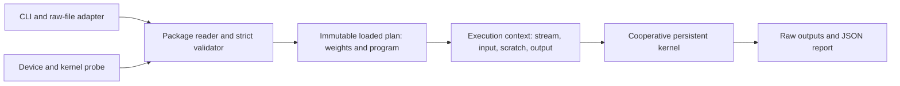

# C++/CUDA runtime for TilePlan

Status: version 1 MLP executor implemented and checked on `tux`, 2026-10-12.
This document describes its current behavior and later design goals for
[the RTX 3050 tile-graph experiment](tile_graph_inference.md). The executor
consumes [TilePlan's Python package](tile_graph_python_architecture.md).
A one-token decoder follows after its state and dependency rules are specified;
a suitable decoder subgraph or focused micrograph will test early tile handoff.

## 1. Runtime contract

The runtime is one Linux executable, initially targeting the RTX 3050 with CUDA 13.4 and driver 595.91.07. It has three jobs: report the actual device and compiled-kernel capabilities, load and validate `plan.json` with `weights.bin`, and run the plan on supplied inputs. The Python `demo` command builds or locates this executable, calls its capability query, runs TilePlan, invokes the executable again, and compares its outputs with PyTorch's saved reference values. The runtime never executes Python or rebuilds a schedule during inference.

| Input or output | Contract |
| --- | --- |
| `plan.json` | Versioned model, tensor, task, wave, storage, target, and integrity metadata. |
| `weights.bin` | Read-only, little-endian float32 weights in the manifest's byte order. |
| Input | One or more contiguous float32 vectors of length `D`; values vary between invocations. |
| Output | One float32 vector of length `O` per input; diagnostic mode also returns hidden vector `h` of length `H`. |
| Report | Successful runs write JSON with plan identity, dimensions, input hash, and timing data. Errors return nonzero and print a diagnostic to stderr. |

The CLI uses one execution context and one in-flight invocation at a time. Repeated inputs reuse the uploaded weights, instructions, allocations, and schedule. Sharing one uploaded immutable plan among several contexts is a future extension.

## 2. Components and ownership



| Component | Responsibility |
| --- | --- |
| **Target probe** | Query CUDA device properties and the compiled kernel, then print raw JSON for TilePlan's `probe` command. |
| **Package reader** | Parse schema, verify `weights.bin` size and SHA-256, and reject malformed or unsupported packages before GPU allocation. |
| **Plan validator** | Check model shapes, tasks, waves, buffer bounds, target fingerprint, and cooperative launch feasibility against the *current* executable and GPU. |
| **Program encoder** | Turn string opcodes and tensor names into compact fixed-layout device records and per-worker wave ranges. |
| **Loaded plan** | Hold validated host weights and encoded tasks; the current executor uploads and owns device copies for its context. |
| **Execution context** | Own mutable `h` scratch, optional staging buffers, a CUDA stream, and the one-in-flight-call rule. |
| **Runner and reporter** | Accept raw inputs, enqueue the kernel, return outputs and timing JSON; print errors to stderr with nonzero exit status. |

### CUDA API layer

**Decision: CCCL Runtime is used after the cooperative-launch gate passed on the target RTX 3050.** The documented CCCL 3.2 API includes `cuda::make_config` with `cuda::cooperative_launch{}` and `cuda::launch` for a kernel that calls `grid.sync()`. Use `cuda::stream` for an owned execution stream, `cuda::stream_ref` for borrowed stream arguments, `cuda::device_buffer<T>`/`cuda::buffer` for stream-ordered device storage, and `cuda::std::span<T>` for sized, non-owning kernel views. CCCL's [runtime overview](https://nvidia.github.io/cccl/unstable/libcudacxx/runtime.html), [cooperative launch example](https://nvidia.github.io/cccl/unstable/libcudacxx/runtime/launch.html), [buffer documentation](https://nvidia.github.io/cccl/unstable/libcudacxx/runtime/buffer.html), and [stream documentation](https://nvidia.github.io/cccl/unstable/libcudacxx/runtime/stream.html) describe these interfaces.

The CTest gate compiles and runs a small CCCL-configured cooperative kernel on the actual RTX 3050. Its blocks write data, call `grid.sync()`, and verify what the other blocks wrote. It uses the intended block size, one block per reported SM, a CCCL-owned stream, buffer/span arguments, and a CCCL timed event. The gate passed with 20 blocks of 128 threads. The executor therefore uses CCCL for streams, buffers, transfers, launches, and timed events. Keep this gate in the test suite when the kernel or toolchain changes.

Version 1 uses one explicit CCCL stream for ordered uploads and launches; a loaded plan is exposed only after its uploads complete. Construct typed buffers with that stream and a device-accessible memory resource, initially the selected device's default memory pool. If loading later becomes asynchronous, contexts on other streams need an explicit completion dependency before using those buffers. The owning stream must outlive buffers whose destruction enqueues deallocation on it; host input backing a stream-ordered copy must also remain alive until that copy completes. Use `cuda::no_init` for buffers that are fully overwritten before reading. CCCL API failures are caught at the executable boundary and reported on stderr with a nonzero exit status. The [CCCL buffer construction and lifetime rules](https://nvidia.github.io/cccl/unstable/libcudacxx/runtime/buffer.html) and [CUDA Runtime interop guide](https://nvidia.github.io/cccl/unstable/libcudacxx/runtime/cudart_interactions.html) cover these ownership details.

Host-side parsing, validation, and reporting use C++23. The initial `.cu` translation unit and any headers included by device code use C++20-compatible constructs, matching the project build configuration. Keep the device program's plain-data layout in a small shared header that both compilation paths can read.

## 3. Capability query and target agreement

The executable exposes `--describe-target-json`. It reports the CUDA device name/identity, compute capability, SM count, global-memory and per-SM limits, cooperative-launch support, driver/runtime versions, and the compiled worker kernel's ABI, supported opcodes/GELU variant, threads per block, register count, static shared-memory use, and active blocks per SM. The kernel-specific occupancy value comes from `cudaOccupancyMaxActiveBlocksPerMultiprocessor` using the **final compiled worker kernel** and launch parameters; register/shared-memory figures come from `cudaFuncGetAttributes`. A smoke-test or stub kernel's occupancy is never used to create `target.json`. Reprobe after an operator or kernel build change. [CUDA's occupancy API](https://docs.nvidia.com/cuda/cuda-runtime-api/cuda_runtime_api/group__CUDART__OCCUPANCY.html) and [function attributes](https://docs.nvidia.com/cuda/archive/13.2.0/cuda-runtime-api/structcudaFuncAttributes.html) are the sources for these fields.

Python's probe derives `target.json` from that report. For version 1, `worker_count = SM_count`, `grid_blocks = worker_count`, and the chosen block size is the executor's reported block size. The runtime independently recomputes the legal cooperative bound, `SM_count × active_blocks_per_SM`, and requires `grid_blocks` to fit. It also requires cooperative-launch support. The plan may assign worker IDs by block index, but neither probe nor executor assumes a particular block runs on a particular physical SM: CUDA does not promise that mapping. [CUDA's block scheduling description](https://docs.nvidia.com/cuda/cuda-programming-guide/02-basics/writing-cuda-kernels.html#kernel-launch-and-occupancy) is explicit about this limit.

The executor ABI/fingerprint includes opcode meanings, operator implementation variant, GELU variant, task-record layout, block size, and compiled kernel variant. A mismatched ABI or changed SM count requires a new plan. Driver and runtime versions are recorded in the target report; the runtime rejects based on the required capabilities and ABI rather than demanding the same driver patch number.

The low-level CUDA calls above gather device and compiled-kernel facts that TilePlan needs. They do not constitute a second path for launches, streams, buffers, or timing: CCCL owns those runtime operations throughout the executor.

## 4. Loading and validation sequence

Loading is outside the timed inference path. It performs these steps in order:

1. **Parse and bound-check.** Accept a known plan version and MLP kind. Check positive `D/H/O`, float32 dtype, row-major strides, supported opcodes, unique IDs, and integer arithmetic before multiplying dimensions or forming byte offsets. Reject unknown required fields or conflicting declarations.
2. **Validate storage.** Check every weight/scratch range against its allocation, required alignment, nonoverlap of live writable regions, and exact `weights.bin` size and checksum. Validate `W1=[H,D]`, `b1=[H]`, `W2=[O,H]`, `b2=[O]`, input `[D]`, scratch `h=[H]`, and output `[O]`.
3. **Validate tasks and waves.** Require each `h` row and each `y` row to have exactly one writer; reject duplicate or missing tasks, out-of-range row intervals, incorrect tensor references, and any second-layer task scheduled before all first-layer producers complete. Every task appears once in exactly one worker list. Every worker has the same wave count, including empty waves.
4. **Validate target.** Requery the device and compiled kernel. Match plan worker count, compute capability, executor fingerprint and block size; verify cooperative-launch support and residency bound. Reject a mismatch before GPU allocation and print a diagnostic.
5. **Allocate and encode.** Allocate/upload immutable weights and the compact device program, allocate context scratch, and establish stable input/output bindings. CCCL typed device buffers own these allocations and spans expose their checked extents to kernels; the buffer's stream remains alive through deallocation. Fail cleanly on allocation or copy errors. The plan is ready only after uploads have completed on its setup stream. Compute the SHA-256 of the raw `plan.json` bytes for the run report alongside the already validated weight checksum.

The C++ loader repeats the key checks even though TilePlan validated the package. A plan file can be stale, modified, or generated for a different binary. No raw host/device pointers are serialized.

## 5. Device program and worker kernel

The loader flattens tasks into a device array of fixed-width records. A record contains an opcode, half-open output row range, tensor/buffer selectors, and validated offsets or strides. A second array contains a `(begin, count)` task range for each `(wave, worker)` pair; index `wave × worker_count + blockIdx.x` selects one range. The host checks that all ranges fit the task array and that task records match their wave/worker entries. The kernel receives pointers to this program, the immutable weight allocation, `x`, `h`, and `y`.

The kernel has `worker_count` blocks. Block `i` reads only worker `i`'s ordered tasks for each wave; there is no device work queue or dynamic task assignment. Its conceptual control flow is:

```text
for each wave, identically in every block:
    for each task assigned to this block in that wave:
        execute the task's supported opcode cooperatively within the block
        finish any block-local work before advancing to the next task
    if another wave follows, all blocks reach grid.sync()
```

Configure the worker launch with `cuda::make_config(cuda::block_dims<kThreadsPerBlock>(), cuda::grid_dims(worker_count), cuda::cooperative_launch{})` and submit it with `cuda::launch(stream_ref, config, worker_kernel, ...)`. The kernel uses a grid-wide cooperative group for the wave barrier. Every thread in every block must reach each `grid.sync()`, even when its worker has no tasks in that wave. The barrier orders completion and visibility of `h` writes before any `W2` task reads `h`; the final wave needs no following barrier. Every `W2` row consumes all of `h`, so version 1 cannot overlap the two waves through tile-ready signals. See the [CCCL launch option](https://nvidia.github.io/cccl/unstable/libcudacxx/runtime/launch.html) and [CUDA Cooperative Groups rules](https://docs.nvidia.com/cuda/cuda-programming-guide/04-special-topics/cooperative-groups.html).

### Operator implementation and reuse

For batch one, each `W @ x` stage is a matrix–vector product (GEMV), not a general matrix–matrix multiply. Each opcode calls an inline device routine from inside the persistent worker kernel. A full cuBLAS `gemv` call or CUTLASS device-wide GEMM adapter is a host-side library operation with its own launch path, so neither can be called as the worker's per-tile compute routine while retaining this execution model. [cuBLAS `gemv`](https://docs.nvidia.com/cuda/cublas/index.html#cublas-t-gemv) and [CUTLASS's API hierarchy](https://docs.nvidia.com/cutlass/latest/media/docs/cpp/gemm_api_3x.html) document that boundary.

The first float32 routine assigns one warp to each output row. Its lanes accumulate strided products from that row and the input vector; use [CUB `WarpReduce<float>::Sum`](https://nvidia.github.io/cccl/unstable/cub/api/classcub_1_1WarpReduce.html) for the lane reduction. One lane then adds bias, applies the plan's `gelu_tanh` variant for `W1`, and stores the result; `W2` omits GELU. A block loops over the task's row interval in groups of warps, with out-of-range input lanes contributing zero and tail rows skipped. The runtime owns the indexing, accumulation loop, and epilogue, but reuses the warp collective. There is no child kernel launch or allocation inside a task. CUB temporary storage, register use, and shared memory count toward the **actual persistent kernel's** cooperative residency check. The routine keeps each output row uniquely owned and needs no split-K reduction. Version 1 uses float32 multiplication and accumulation without TF32 or `--use_fast_math`; fused multiply-add and a different reduction order can still differ from PyTorch, so comparison uses the documented tolerance.

[cuBLASDx](https://docs.nvidia.com/cuda/cublasdx/) is a real device-callable GEMM option, including documented support for architecture 86 and float32, but it is an early-access package separate from the CUDA Toolkit and its block tiles use shared memory or register capacity. It is a candidate for a later, larger tile or batched-matmul opcode, once the target probe, compilation, numerical checks, occupancy, and latency establish that it fits the persistent worker. CUTLASS/CuTe lower-level tile components are another later option. Neither library is a version-1 dependency; adding an implementation must preserve TilePlan's task and output contract and be measured as a new kernel variant. [cuBLASDx requirements](https://docs.nvidia.com/cuda/cublasdx/requirements_func.html) and [CUTLASS tiled components](https://docs.nvidia.com/cutlass/latest/media/docs/cpp/gemm_api_3x.html) describe their device-level scope.

Persistence here means each block processes several tile tasks and both MLP stages within **one forward-pass launch**. Weights remain in device global memory and are read by tasks; the design does not assume the whole model fits in registers or shared memory. Because the two first-version waves have a full barrier, fine-grained producer–consumer overlap is reserved for a later schedule format.

## 6. Invocation and Python file bridge

The host loader returns a validated `Plan` with compact tasks and wave ranges. `Executor` owns the CCCL stream and device buffers, uploads the plan once, and runs repeated inputs. The kernel receives sized `cuda::std::span` views backed by those buffers. The CLI serializes invocations and synchronizes for output readback or timing; it never synchronizes between MLP operators. A future library API could share immutable device weights and program data across multiple contexts and accept borrowed streams.

Python keeps the authoritative test fixture in `reference_cases.npz`. The one-command driver converts its input vectors to contiguous little-endian raw float32 for the C++ CLI; the CLI reads those bytes and writes raw `y` (and diagnostic `h`) bytes plus a JSON report. Python reads the raw outputs and compares them with the saved reference. This keeps an NPZ parser and PyTorch dependency out of the C++ runtime. The raw-file protocol takes `D/H/O` from the loaded plan and derives the case count from the input file length; it rejects incomplete vectors.

Implemented executable modes are `--describe-target-json`, `--run-plan PACKAGE --inputs INPUTS.bin --outputs OUTPUTS.bin --report REPORT.json`, and `--benchmark PACKAGE --input BENCH_INPUT.bin --iterations N --rounds R --report REPORT.json`. Python chooses one saved reference input, writes its contiguous float32 bytes to `BENCH_INPUT.bin`, and passes exactly those bytes to this benchmark mode; the report records the input hash. The Python `demo` command calls these modes; users normally need only `python -m tileplan demo --out RUN_DIR` from the parent design. Load, launch, and device errors return nonzero and print a diagnostic to stderr.

## 7. Measurement and baselines

The correctness run checks multiple cases, including zero and seeded random inputs, and can read back `h` to localize an error to wave 0 or wave 1. The benchmark uploads the supplied input once, keeps weights, program, input, scratch, and output on the GPU, warms up, and synchronizes before timed rounds. It measures forward passes with CCCL `cuda::timed_event` objects on the execution stream. The current report records event-bracketed batch-average microseconds per pass across rounds, dimensions, input hash, and plan identity. The `--run-plan` report includes total host-to-host time for its cases. Per-invocation host-to-host distributions, setup costs, tile sizes, and kernel resource figures in every benchmark report remain future work. An event interval can include gaps caused by host submission; profiler kernel durations are separate diagnostics. A round averaging `N` forwards is reported as a batch average, never as an individual-invocation tail percentile. [CUDA's stream and event model](https://docs.nvidia.com/cuda/cuda-programming-guide/02-basics/asynchronous-execution.html) defines these measurements.

The Python benchmark runner owns the PyTorch eager and PyTorch CUDA Graph replay baselines. It loads the same exported weights and inputs, checks their outputs, and combines their timings with this executable's persistent-plan measurements. The C++ runtime contains no separate-kernel baseline or CUDA Graph replay mode. PyTorch may dispatch a different number of kernels for the two MLP stages and use different tiling or fusion; the comparison measures the whole workload rather than the schedule in isolation. A later matched-operator control can reuse this device routine from a separate benchmark target without becoming a runtime mode. Kernel count, occupancy, register spills, memory traffic, and barrier cost are diagnostic measurements; lower latency with correct outputs is the result that matters.

## 8. Current milestone and extension point

The CCCL gate, strict MLP package reader, final-worker target query,
CUB-assisted GEMV opcodes, cooperative wave loop, raw-case execution, hidden
readback, and warmup/benchmark modes are implemented. Generated plans match
PyTorch on sparse and many-task schedules. CTest runs clang-format, unit and
regression tests, and Compute Sanitizer memcheck, racecheck, and synccheck.

Next, freeze a shape and tile-height suite and profile the RTX 3050 before
changing tile or worker policies. A one-token decoder needs specified KV-state
rules, new task opcodes and validation, and a new plan ABI if the program
representation changes. Identify partial tile dependencies in a decoder
subgraph or focused micrograph before evaluating tile-ready signaling.

The first executor does not need cross-block polling, task stealing, persistent operation across requests, or dynamic allocation inside the kernel. A later per-tile readiness protocol requires its own memory-order, progress, and reset design; it should not be added to the wave executor implicitly.
