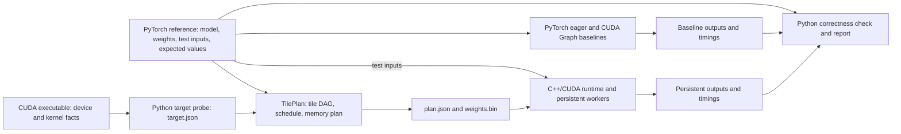

# Statically scheduled tile-graph inference on an RTX 3050

Historical MLP design note. The active decoder package and state ABI are described in [the decoder design](tile_graph_decoder.md); its arithmetic execution is the next milestone.

Status: MLP prototype implemented and checked on the RTX 3050, 2026-10-12.
This document also describes unimplemented experiments; the current commands
and limits are in the [repository README](../README.md).

## Core idea

Conventional inference represents a model as a graph of whole-tensor operations: a matrix multiplication or matrix-vector product finishes, then dependent operations consume its output. Even when an operation runs many tiles in parallel, the graph usually exposes a dependency at the operator boundary.

This prototype represents **each tile of work as a graph node**. [TilePlan](tile_graph_python_architecture.md), an offline Python planner, builds the graph once for a fixed model, shape, precision, and target device configuration. It assigns tile tasks to a fixed set of persistent CUDA worker blocks and writes a versioned execution plan. A C++/CUDA runtime loads that plan and the model weights, accepts input tensors, and executes the plan repeatedly without rebuilding it. The workers stay alive across *operators within one inference invocation*; a permanently running service kernel across requests is a possible later experiment.

**First hypothesis:** for small, fixed-shape, latency-sensitive inference on an RTX 3050, a precomputed tile schedule executed within one persistent kernel can reduce latency by keeping both MLP stages within one cooperative launch. The benefit must exceed dispatch, synchronization, and resource costs. This is a measurement question, not an assumed speedup.

**Later hypothesis:** a tile graph can shorten the critical path further when a consumer tile depends on only part of its producer's output and can start before the whole producer operation finishes. The first dense MLP does not have that property: every `W2` row reads all of `h`, so all `W1` tiles must finish before any `W2` tile starts. Its two-wave barrier is therefore consistent with the true dependency graph. A specified decoder subgraph, or a focused companion micrograph if needed, must expose partial dependencies before testing early tile handoff.

The RTX 3050 is the actual target, rather than a proxy for a data-center GPU. The plan must fit its measured memory and per-SM resource limits. The runtime queries the installed device; it does not assume one universal RTX 3050 SM count, memory size, or clock rate.

## Scope of the first experiment

| Item | Initial choice |
| --- | --- |
| Workload | One fixed-shape, batch-one forward pass; no dynamic batching or variable graph structure. |
| First graph | A two-layer MLP: `h = GELU(W1 × x + b1)`, `y = W2 × h + b2`. This exercises tiled matrix-vector products, a fused pointwise operation, and a full-layer dependency. |
| Next graph | A Llama-style, batch-one, one-token decoder block with RMSNorm, RoPE, grouped-query attention, a per-layer KV cache, and SwiGLU; see the [decoder design](tile_graph_decoder.md). Begin with full wave barriers and synthetic float32 weights, then target the Llama 3.2 1B base checkpoint with BF16 weights. |
| Precision | Float32 inputs, weights, and accumulation; fix PyTorch's TF32 policy and the executor's math mode before comparing outputs or timings. |
| Test model | A PyTorch reference creates a small deterministic MLP, exports its weights and test inputs, and computes expected intermediate and final values. |
| Planning | Python expands tensor operations into tile tasks, dependencies, buffer lifetimes, and an assignment to logical workers. Planning happens once per supported model/shape/device configuration. |
| Execution | C++ loads and validates the plan; CUDA worker blocks follow their assigned task sequences during each invocation. Inputs change; the graph and schedule do not. |
| First operator implementation | Batch-one matrix–vector tasks use device routines inside the persistent kernel and CUB warp reduction. The CCCL cooperative-launch gate passed on the RTX 3050. |
| Primary metric | CUDA-event elapsed time per GPU-resident forward pass, compared with PyTorch eager execution and PyTorch CUDA Graph replay of the same MLP. |

The MLP is a scheduling test, not a claim that it represents full language-model inference. The [decoder design](tile_graph_decoder.md) now specifies KV state, context length, the block's operations, and the path to full-model logits and checkpoint weights. Those features are planned, not implemented.

## Implemented MLP pipeline

1. **Create the reference model.** A PyTorch script constructs the small float32 MLP with a fixed seed, exports `model.json` and `weights.npz`, and saves test inputs with expected `h` and `y` values in `reference_cases.npz`. These artifacts define both what TilePlan compiles and what the CUDA result must match.
2. **Probe the target.** The pipeline builds or locates the final CUDA executable, with its actual GEMV device routine compiled into the worker kernel. TilePlan's `probe` command asks it for raw device properties and kernel-specific capabilities, then derives `target.json`: one logical worker per reported SM, the executor's block size, and a cooperative launch configuration that fits the reported residency limit. It fails early if the required launch is unsupported. The runtime validates the same facts again when loading the plan.
3. **Build the tile graph and schedule.** TilePlan consumes the reference model and `target.json`. Each task records an operation kind, tile coordinates, buffer slices, and predecessors. It assigns independent tiles to workers in topological waves and computes a versioned memory plan. The [Python architecture](tile_graph_python_architecture.md) specifies these passes and the plan format.
4. **Load and run.** The C++/CUDA runtime validates `plan.json` and `weights.bin`, allocates stable device buffers, and executes the test inputs. Worker blocks follow their preassigned task lists, synchronizing between waves. Inputs can remain on the GPU for execution measurements; host-to-host latency is reported separately. The [runtime design](tile_graph_cuda_runtime.md) defines its loader, worker kernel, and measurement interface.
5. **Check and report.** Python runs PyTorch eager and CUDA Graph replay baselines from the same exported weights and inputs, compares all outputs with the saved reference, and records correctness, plan identity, and timings. The working entry point, `python -m tileplan demo --out RUN_DIR`, orchestrates all five stages, including the executable build and baselines, and leaves their artifacts together for inspection. Detailed profiling can run against the same package.

The initial plan format can be human-readable JSON plus a separate weight file. A compact binary format is warranted only if plan loading becomes material; parsing is outside the measured inference path. A loaded plan can serve many inference inputs without repeating the Python planning stage.

## CUDA execution model and synchronization

A logical worker is a CUDA thread block. Blocks execute on SMs, but CUDA does **not** offer a normal launch-time guarantee that worker `i` runs on physical SM `i`; correctness and memory ownership cannot depend on that mapping. The planner targets a number of simultaneously resident workers, not a physical SM affinity. [CUDA's execution model](https://docs.nvidia.com/cuda/cuda-programming-guide/02-basics/writing-cuda-kernels.html#kernel-launch-and-occupancy) describes this placement limit.

For the first wave-based implementation, use a cooperative launch and `grid.sync()` between waves. Every worker must reach each barrier, including workers with no task in that wave. At load time, check cooperative-launch support and compute a legal grid size from the compiled kernel's block size, register/shared-memory use, occupancy, and device SM count. A plan generated for a different worker count must be rejected or regenerated. [CUDA's cooperative-groups guide](https://docs.nvidia.com/cuda/cuda-programming-guide/04-special-topics/cooperative-groups.html) and [occupancy example](https://docs.nvidia.com/cuda/cuda-programming-guide/05-appendices/device-callable-apis.html) define the required launch and grid synchronization behavior.

Cross-worker intermediate tiles live in device memory; a block may retain values in registers or shared memory for tasks it executes locally. The later fine-grained version needs explicit publication and acquisition of tile-ready state, with a validated schedule that cannot deadlock while workers wait. It also needs a way to reset that state before every invocation. Start with barriers so correctness and performance costs are visible before adding this complexity.

One combined kernel has one resource footprint. A heavy task can raise register or shared-memory demand for every worker, reducing residency; dispatch branches and instruction size also cost time. The first task vocabulary should therefore stay small. If a decoder block creates incompatible resource needs, splitting it into a few persistent stages may outperform a single model-wide kernel.

## How to test the hypothesis

1. Use the PyTorch-generated MLP and saved reference values to compare numerical outputs over seeded random, zero, and tail-tile cases. Fix weights, float32 policy, activation, and output tolerances before timing; report maximum absolute and tolerance-normalized error for both `h` and `y`.
2. Run the same MLP in PyTorch eager mode and capture that PyTorch operation sequence for CUDA Graph replay. Use identical dimensions, exported weights, float32 policy, activation, and inputs. The Python benchmark runner owns both baselines; the C++ runtime only executes the tile plan. Graph replay controls for repeated host submission overhead.
3. Warm up and measure repeated GPU-resident invocations using the same saved benchmark input for all three paths. Report CUDA-event elapsed time and host-to-host latency separately; event intervals can include stream gaps between eager launches. Freeze the MLP shape and tile-height candidates before measurement; use pilot rounds to choose a tile height, report all candidates, and evaluate the chosen plan in independent final rounds. Label tail latency only when measured from individual invocations, rather than averages of batches.
4. Profile register count, shared-memory use, achieved occupancy, memory traffic, barrier time, and GPU timeline gaps. A speedup is useful only if it survives the same RTX 3050 workload and correctness checks.
5. Add a specified decoder block and repeat the comparison. Identify a decoder subgraph with explicit partial tile dependencies, or use a focused companion micrograph, before claiming early handoff. If the persistent design loses, use the measurements to identify whether bandwidth, barriers, worker imbalance, or the combined kernel's resource footprint is responsible.

The primary result is a latency-versus-shape comparison against PyTorch CUDA Graph replay, accompanied by a profile that explains the difference. PyTorch may use different kernels, fusion, and tiling, so this is an end-to-end workload comparison, not proof that static scheduling alone caused a speedup. A separate matched-operator control, outside the production runtime, is needed before attributing a difference specifically to scheduling. A lower kernel count alone does not validate the hypothesis.

## For the next iteration

- Freeze a shape and tile-height suite, run independent pilot and final rounds, and profile the worker on the RTX 3050. The single demo run is a correctness and pipeline check, not a tuned comparison.
- Build the [one-token decoder milestones](tile_graph_decoder.md): reference semantics, a new plan/state ABI, one block, a full stack, BF16 weight support, and the pinned Llama 3.2 1B checkpoint bridge. Use wave barriers first; identify a partial-dependency subgraph or focused micrograph before evaluating tile-ready signaling.
- Start with one logical worker per SM. Evaluate more resident workers only after measuring the first configuration.
- Open question: which partial-dependency workload warrants replacing wave barriers with per-tile readiness signals?
